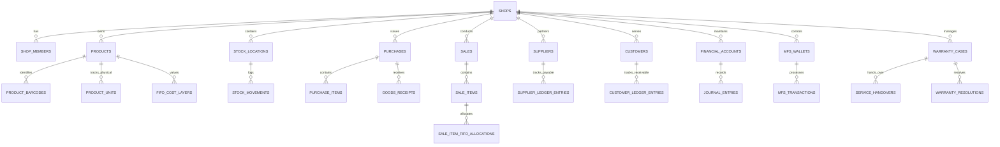

# DATABASE DESIGN & RELATIONAL DATA MODEL
**System Name:** Ruphaidah Shop Management System (RSMS)  
**Document Version:** 1.0.0  
**Status:** Approved for Implementation Planning  
**Target RDBMS:** PostgreSQL 15+ (Supabase)  
**Base Currency:** BDT (Bangladeshi Taka, `NUMERIC(15, 2)` / `NUMERIC(18, 4)`)  

> [!NOTE]
> This document defines the architectural data model, entity boundaries, relational constraints, and data integrity safeguards. It is a conceptual and logical design specification, not a finalized executable migration script.

---

## 1. Relational Entity Domain Overview

The database is structured into 11 coherent functional domains:

---

## 2. Detailed Entity Catalog & Specifications

### Domain 1: Multi-Tenancy, Profiles, RBAC & Audit Logs

#### `shops`
- **Purpose:** Represents the top-level business or tenant entity.
- **Primary Key:** `id UUID DEFAULT gen_random_uuid()`
- **Key Columns:** `name VARCHAR(255)`, `legal_name VARCHAR(255)`, `phone VARCHAR(32)`, `address TEXT`, `currency VARCHAR(3) DEFAULT 'BDT'`, `timezone VARCHAR(64) DEFAULT 'Asia/Dhaka'`, `created_at TIMESTAMPTZ`.
- **Classification:** Administrative / Multi-Tenant Root.

#### `profiles`
- **Purpose:** Public profile details linked 1:1 with `auth.users`.
- **Primary Key:** `id UUID REFERENCES auth.users(id) ON DELETE CASCADE`
- **Key Columns:** `full_name VARCHAR(255)`, `phone VARCHAR(32)`, `avatar_url TEXT`, `created_at TIMESTAMPTZ`.
- **Classification:** Authentication Profile.

#### `shop_members`
- **Purpose:** Cross-reference table linking users to shops with assigned roles.
- **Primary Key:** `(shop_id, user_id)`
- **Key Columns:** `shop_id UUID REFERENCES shops(id) ON DELETE CASCADE`, `user_id UUID REFERENCES auth.users(id) ON DELETE CASCADE`, `role VARCHAR(32) NOT NULL CHECK (role IN ('owner', 'staff'))`, `is_active BOOLEAN DEFAULT true`, `joined_at TIMESTAMPTZ`.
- **Classification:** Authorization / RBAC.

#### `audit_logs`
- **Purpose:** Append-only immutable log of sensitive business mutations.
- **Primary Key:** `id UUID DEFAULT gen_random_uuid()`
- **Key Columns:** `shop_id UUID NOT NULL REFERENCES shops(id)`, `actor_user_id UUID REFERENCES auth.users(id)`, `entity_type VARCHAR(64) NOT NULL`, `entity_id UUID NOT NULL`, `action VARCHAR(32) NOT NULL (INSERT/UPDATE/VOID)`, `old_values JSONB`, `new_values JSONB`, `ip_address INET`, `created_at TIMESTAMPTZ NOT NULL`.
- **Classification:** Security & Audit.

---

### Domain 2: Product Catalog, Barcodes & Physical Unit Identity

#### `categories` & `brands`
- **Purpose:** Taxonomic classification of merchandise.
- **Primary Key:** `id UUID DEFAULT gen_random_uuid()`
- **Tenant Key:** `shop_id UUID NOT NULL REFERENCES shops(id)`
- **Key Columns:** `name VARCHAR(255) NOT NULL`, `slug VARCHAR(255) NOT NULL`, `parent_id UUID (for categories)`.
- **Unique Constraint:** `UNIQUE (shop_id, slug)`.

#### `products`
- **Purpose:** Defines the conceptual catalog item / SKU.
- **Primary Key:** `id UUID DEFAULT gen_random_uuid()`
- **Tenant Key:** `shop_id UUID NOT NULL REFERENCES shops(id)`
- **Key Columns:**
  - `sku VARCHAR(64) NOT NULL` (Unique per shop)
  - `name VARCHAR(255) NOT NULL` (e.g., "Remax 20W Type-C Fast Charger")
  - `category_id UUID REFERENCES categories(id)`
  - `brand_id UUID REFERENCES brands(id)`
  - `unit_of_measure VARCHAR(32) DEFAULT 'piece'` (e.g., piece, packet, box, meter)
  - `default_selling_price NUMERIC(15, 2) NOT NULL CHECK (default_selling_price >= 0)`
  - `min_selling_price NUMERIC(15, 2) DEFAULT 0`
  - `reorder_threshold INT DEFAULT 5`
  - `has_serialized_units BOOLEAN DEFAULT false` (True for phones/high-value electronics; False for pens/stationery)
  - `warranty_period_days INT DEFAULT 0`
  - `is_active BOOLEAN DEFAULT true`
- **Classification:** Master Catalog Data.

#### `product_barcodes`
- **Purpose:** Maps one or more 1D/2D barcodes to a single product SKU.
- **Primary Key:** `id UUID DEFAULT gen_random_uuid()`
- **Tenant Key:** `shop_id UUID NOT NULL REFERENCES shops(id)`
- **Key Columns:**
  - `product_id UUID NOT NULL`
  - `barcode VARCHAR(128) NOT NULL`
  - `barcode_type VARCHAR(32) DEFAULT 'manufacturer' CHECK (barcode_type IN ('manufacturer', 'internal', 'qr_code'))`
  - `is_primary BOOLEAN DEFAULT true`
- **Constraints:** `UNIQUE (shop_id, barcode)`, composite FK: `FOREIGN KEY (shop_id, product_id) REFERENCES products(shop_id, id) ON DELETE CASCADE`.
- **Critical Barcode Rule:** If an existing manufacturer code is scanned, it is registered here. Only if no code exists does the system generate an internal `RS-XXXXXX` code.

#### `product_units`
- **Purpose:** Tracks specific physical units for serialized electronics (IMEI, Serial Number). **Bulk goods (e.g., pens, stationery, cables without serials) do NOT create records in this table.**
- **Primary Key:** `id UUID DEFAULT gen_random_uuid()`
- **Tenant Key:** `shop_id UUID NOT NULL REFERENCES shops(id)`
- **Key Columns:**
  - `product_id UUID NOT NULL`
  - `serial_number VARCHAR(128)` (Manufacturer Serial, optional)
  - `imei_1 VARCHAR(32)` (For mobile devices/routers, optional)
  - `imei_2 VARCHAR(32)`
  - `internal_unit_tag VARCHAR(64) NOT NULL` (Unique physical asset tag)
  - `status VARCHAR(32) DEFAULT 'available' CHECK (status IN ('available', 'reserved', 'sold', 'defective', 'at_service_center', 'replaced', 'disposed'))`
  - `cost_layer_id UUID REFERENCES fifo_cost_layers(id)`
  - `sale_item_id UUID`
- **Constraints:** `UNIQUE (shop_id, internal_unit_tag)`, partial unique constraints on `(shop_id, serial_number)` where serial is not null.

---

### Domain 3: Stock Locations, Inventory & FIFO Cost Layers

#### `stock_locations`
- **Purpose:** Physical warehouse or shop store location.
- **Primary Key:** `id UUID DEFAULT gen_random_uuid()`
- **Tenant Key:** `shop_id UUID NOT NULL REFERENCES shops(id)`
- **Key Columns:** `name VARCHAR(128) NOT NULL`, `code VARCHAR(32) NOT NULL`, `is_default BOOLEAN DEFAULT true`.
- **Unique Constraint:** `UNIQUE (shop_id, code)`.

#### `fifo_cost_layers`
- **Purpose:** Core FIFO valuation engine. Stores historical batches of received inventory with exact purchase costs and unconsumed quantities.
- **Primary Key:** `id UUID DEFAULT gen_random_uuid()`
- **Tenant Key:** `shop_id UUID NOT NULL REFERENCES shops(id)`
- **Key Columns:**
  - `product_id UUID NOT NULL`
  - `stock_location_id UUID NOT NULL`
  - `batch_reference VARCHAR(64)` (e.g., Purchase Receipt #, Opening Stock Tag)
  - `source_type VARCHAR(32) NOT NULL CHECK (source_type IN ('opening_stock', 'purchase_receipt', 'return_restock', 'inventory_adjustment'))`
  - `source_id UUID NOT NULL` (Polymorphic ID of goods receipt, opening stock, etc.)
  - `unit_cost NUMERIC(18, 4) NOT NULL CHECK (unit_cost >= 0)`
  - `original_quantity NUMERIC(15, 3) NOT NULL CHECK (original_quantity > 0)`
  - `remaining_quantity NUMERIC(15, 3) NOT NULL CHECK (remaining_quantity >= 0)`
  - `received_at TIMESTAMPTZ NOT NULL`
- **Constraints:** `CHECK (remaining_quantity <= original_quantity)`.
- **Indexing:** High-performance index on `(shop_id, product_id, stock_location_id, received_at ASC) WHERE remaining_quantity > 0`.

#### `stock_movements`
- **Purpose:** Append-only ledger of every physical stock addition, deduction, transfer, and status change.
- **Primary Key:** `id UUID DEFAULT gen_random_uuid()`
- **Tenant Key:** `shop_id UUID NOT NULL REFERENCES shops(id)`
- **Key Columns:**
  - `product_id UUID NOT NULL`
  - `stock_location_id UUID NOT NULL`
  - `movement_type VARCHAR(32) NOT NULL CHECK (movement_type IN ('opening_stock', 'purchase_receive', 'sale_out', 'sale_return_in', 'supplier_return_out', 'adjustment_loss', 'adjustment_gain', 'service_center_out', 'service_center_in'))`
  - `quantity NUMERIC(15, 3) NOT NULL` (Signed: positive for in, negative for out)
  - `source_document_type VARCHAR(32)`
  - `source_document_id UUID`
  - `created_at TIMESTAMPTZ NOT NULL DEFAULT clock_timestamp()`
  - `created_by UUID REFERENCES auth.users(id)`

---

### Domain 4: Suppliers, Purchasing & Goods Receiving

#### `suppliers`
- **Purpose:** Vendor and distributor directory.
- **Primary Key:** `id UUID DEFAULT gen_random_uuid()`
- **Tenant Key:** `shop_id UUID NOT NULL REFERENCES shops(id)`
- **Key Columns:** `name VARCHAR(255) NOT NULL`, `contact_person VARCHAR(128)`, `phone VARCHAR(32) NOT NULL`, `address TEXT`, `current_payable_balance NUMERIC(15, 2) DEFAULT 0`.

#### `purchases`
- **Purpose:** Commercial purchase order / bill header from a supplier.
- **Primary Key:** `id UUID DEFAULT gen_random_uuid()`
- **Tenant Key:** `shop_id UUID NOT NULL REFERENCES shops(id)`
- **Key Columns:**
  - `purchase_number VARCHAR(64) NOT NULL` (e.g., `PO-2026-0001`)
  - `supplier_id UUID NOT NULL REFERENCES suppliers(id)`
  - `order_date DATE NOT NULL`
  - `total_cost_amount NUMERIC(15, 2) NOT NULL`
  - `discount_amount NUMERIC(15, 2) DEFAULT 0`
  - `tax_amount NUMERIC(15, 2) DEFAULT 0`
  - `net_payable_amount NUMERIC(15, 2) NOT NULL`
  - `status VARCHAR(32) DEFAULT 'draft' CHECK (status IN ('draft', 'ordered', 'received_partial', 'received_full', 'cancelled'))`
  - `notes TEXT`
- **Invariants:** Creating a purchase order does **NOT** increment inventory.

#### `purchase_items`
- **Purpose:** Line items on a purchase order.
- **Primary Key:** `id UUID DEFAULT gen_random_uuid()`
- **Tenant Key:** `shop_id UUID NOT NULL REFERENCES shops(id)`
- **Key Columns:**
  - `purchase_id UUID NOT NULL`
  - `product_id UUID NOT NULL`
  - `ordered_quantity NUMERIC(15, 3) NOT NULL CHECK (ordered_quantity > 0)`
  - `received_quantity NUMERIC(15, 3) NOT NULL DEFAULT 0`
  - `unit_cost NUMERIC(18, 4) NOT NULL CHECK (unit_cost >= 0)`
  - `line_total NUMERIC(15, 2) NOT NULL`
- **Constraints:** Composite FK `(shop_id, purchase_id) REFERENCES purchases(shop_id, id)`.

#### `goods_receipts` & `goods_receipt_items`
- **Purpose:** Official warehouse intake record. **Stock and FIFO cost layers are ONLY created upon posting a Goods Receipt.**
- **Primary Key:** `id UUID DEFAULT gen_random_uuid()`
- **Tenant Key:** `shop_id UUID NOT NULL REFERENCES shops(id)`
- **Key Columns:** `receipt_number VARCHAR(64)`, `purchase_id UUID REFERENCES purchases(id)`, `stock_location_id UUID NOT NULL`, `received_date TIMESTAMPTZ NOT NULL`, `received_by UUID REFERENCES auth.users(id)`.

---

### Domain 5: Sales, POS, Sale Items & FIFO Allocations

#### `customers`
- **Purpose:** Customer directory for retail patrons, accounts, and "Baki" (credit dues).
- **Primary Key:** `id UUID DEFAULT gen_random_uuid()`
- **Tenant Key:** `shop_id UUID NOT NULL REFERENCES shops(id)`
- **Key Columns:** `name VARCHAR(255) NOT NULL`, `phone VARCHAR(32)`, `address TEXT`, `credit_limit NUMERIC(15, 2) DEFAULT 0`, `current_due_balance NUMERIC(15, 2) DEFAULT 0`.

#### `sales`
- **Purpose:** Customer checkout receipt / invoice header.
- **Primary Key:** `id UUID DEFAULT gen_random_uuid()`
- **Tenant Key:** `shop_id UUID NOT NULL REFERENCES shops(id)`
- **Key Columns:**
  - `invoice_number VARCHAR(64) NOT NULL` (e.g., `INV-2026-00042`)
  - `customer_id UUID REFERENCES customers(id)` (Nullable for anonymous walk-ins)
  - `sale_timestamp TIMESTAMPTZ NOT NULL DEFAULT clock_timestamp()`
  - `subtotal_amount NUMERIC(15, 2) NOT NULL`
  - `discount_amount NUMERIC(15, 2) DEFAULT 0`
  - `tax_amount NUMERIC(15, 2) DEFAULT 0`
  - `grand_total NUMERIC(15, 2) NOT NULL`
  - `paid_amount NUMERIC(15, 2) NOT NULL`
  - `due_amount NUMERIC(15, 2) NOT NULL`
  - `total_cogs_amount NUMERIC(15, 2) NOT NULL` (Sum of allocated FIFO costs)
  - `status VARCHAR(32) DEFAULT 'completed' CHECK (status IN ('completed', 'voided', 'returned_partial', 'returned_full'))`
  - `client_mutation_id UUID UNIQUE` (Idempotency key from client)
  - `created_by UUID REFERENCES auth.users(id)`
- **Constraints:** `CHECK (grand_total = (paid_amount + due_amount))`.

#### `sale_items`
- **Purpose:** Individual products sold on a sale.
- **Primary Key:** `id UUID DEFAULT gen_random_uuid()`
- **Tenant Key:** `shop_id UUID NOT NULL REFERENCES shops(id)`
- **Key Columns:**
  - `sale_id UUID NOT NULL`
  - `product_id UUID NOT NULL`
  - `quantity NUMERIC(15, 3) NOT NULL CHECK (quantity > 0)`
  - `unit_price NUMERIC(15, 2) NOT NULL`
  - `discount_amount NUMERIC(15, 2) DEFAULT 0`
  - `line_total NUMERIC(15, 2) NOT NULL`
  - `line_cogs NUMERIC(15, 2) NOT NULL` (Calculated from FIFO layer allocations)

#### `sale_item_fifo_allocations`
- **Purpose:** Explicit audit bridge mapping which specific FIFO cost layer satisfied which sale item.
- **Primary Key:** `id UUID DEFAULT gen_random_uuid()`
- **Tenant Key:** `shop_id UUID NOT NULL REFERENCES shops(id)`
- **Key Columns:**
  - `sale_item_id UUID NOT NULL REFERENCES sale_items(id) ON DELETE CASCADE`
  - `fifo_cost_layer_id UUID NOT NULL REFERENCES fifo_cost_layers(id)`
  - `allocated_quantity NUMERIC(15, 3) NOT NULL CHECK (allocated_quantity > 0)`
  - `unit_cost NUMERIC(18, 4) NOT NULL`
  - `total_cost NUMERIC(15, 2) NOT NULL`

#### `sale_payments`
- **Purpose:** Payment tenders received for a sale (allows split payments).
- **Primary Key:** `id UUID DEFAULT gen_random_uuid()`
- **Tenant Key:** `shop_id UUID NOT NULL REFERENCES shops(id)`
- **Key Columns:**
  - `sale_id UUID NOT NULL REFERENCES sales(id)`
  - `payment_method VARCHAR(32) NOT NULL CHECK (payment_method IN ('cash', 'bkash', 'nagad', 'rocket', 'bank_transfer', 'customer_credit'))`
  - `amount NUMERIC(15, 2) NOT NULL CHECK (amount > 0)`
  - `financial_account_id UUID REFERENCES financial_accounts(id)`
  - `transaction_reference VARCHAR(128)` (e.g., MFS TrxID)

---

### Domain 6: Supplier Ledger, Returns & Vendor Exchanges

#### `supplier_ledger_entries`
- **Purpose:** Running financial ledger tracking debts, payments, and credit notes for each supplier.
- **Primary Key:** `id UUID DEFAULT gen_random_uuid()`
- **Tenant Key:** `shop_id UUID NOT NULL REFERENCES shops(id)`
- **Key Columns:**
  - `supplier_id UUID NOT NULL REFERENCES suppliers(id)`
  - `entry_type VARCHAR(32) NOT NULL CHECK (entry_type IN ('purchase_invoice', 'supplier_payment', 'purchase_return_credit', 'exchange_adjustment'))`
  - `debit_amount NUMERIC(15, 2) DEFAULT 0` (Reduces payable)
  - `credit_amount NUMERIC(15, 2) DEFAULT 0` (Increases payable)
  - `balance_after NUMERIC(15, 2) NOT NULL`
  - `source_document_id UUID NOT NULL`

#### `purchase_returns` & `purchase_return_items`
- **Purpose:** Tracks merchandise returned back to a vendor for a refund or account credit.
- **Primary Key:** `id UUID DEFAULT gen_random_uuid()`
- **Tenant Key:** `shop_id UUID NOT NULL REFERENCES shops(id)`
- **Key Columns:** `return_number VARCHAR(64)`, `supplier_id UUID NOT NULL`, `return_reason TEXT`, `credit_note_number VARCHAR(64)`, `total_refund_amount NUMERIC(15, 2)`.

#### `supplier_exchanges`
- **Purpose:** Handles complex supplier exchanges where defective Product A is replaced by vendor with a different Product B (with possible price differential).
- **Primary Key:** `id UUID DEFAULT gen_random_uuid()`
- **Tenant Key:** `shop_id UUID NOT NULL REFERENCES shops(id)`
- **Key Columns:**
  - `exchange_number VARCHAR(64)`
  - `supplier_id UUID NOT NULL`
  - `returned_product_id UUID NOT NULL REFERENCES products(id)`
  - `returned_quantity NUMERIC(15, 3) NOT NULL`
  - `returned_credited_unit_cost NUMERIC(15, 2) NOT NULL`
  - `replacement_product_id UUID NOT NULL REFERENCES products(id)`
  - `replacement_quantity NUMERIC(15, 3) NOT NULL`
  - `replacement_billed_unit_cost NUMERIC(15, 2) NOT NULL`
  - `net_financial_adjustment NUMERIC(15, 2) NOT NULL` (Billed - Credited)
  - `status VARCHAR(32) DEFAULT 'completed'`

---

### Domain 7: Financial Accounts, Journal Entries & Expenses

#### `financial_accounts` (Chart of Accounts)
- **Purpose:** Cash drawers, bank accounts, and MFS float balances.
- **Primary Key:** `id UUID DEFAULT gen_random_uuid()`
- **Tenant Key:** `shop_id UUID NOT NULL REFERENCES shops(id)`
- **Key Columns:**
  - `account_code VARCHAR(32) NOT NULL`
  - `account_name VARCHAR(128) NOT NULL` (e.g., "Counter Cash Drawer", "bKash Agent Float", "City Bank")
  - `account_type VARCHAR(32) NOT NULL CHECK (account_type IN ('asset', 'liability', 'equity', 'revenue', 'expense'))`
  - `current_balance NUMERIC(15, 2) DEFAULT 0`
  - `is_system_account BOOLEAN DEFAULT false`

#### `journal_entries` & `journal_lines`
- **Purpose:** Immutable double-entry bookkeeping ledger.
- **Rule:** Every financial transaction creates at least one debit line and one credit line where `SUM(debit) == SUM(credit)`.
- **Primary Key:** `id UUID DEFAULT gen_random_uuid()`
- **Tenant Key:** `shop_id UUID NOT NULL REFERENCES shops(id)`
- **Key Columns (`journal_lines`):**
  - `journal_entry_id UUID NOT NULL REFERENCES journal_entries(id) ON DELETE CASCADE`
  - `financial_account_id UUID NOT NULL REFERENCES financial_accounts(id)`
  - `debit_amount NUMERIC(15, 2) DEFAULT 0 CHECK (debit_amount >= 0)`
  - `credit_amount NUMERIC(15, 2) DEFAULT 0 CHECK (credit_amount >= 0)`
  - `narration TEXT`

#### `expenses`
- **Purpose:** Operating expenses (rent, electricity, salaries, tea/entertainment, printer supplies).
- **Primary Key:** `id UUID DEFAULT gen_random_uuid()`
- **Tenant Key:** `shop_id UUID NOT NULL REFERENCES shops(id)`
- **Key Columns:** `expense_category VARCHAR(64) NOT NULL`, `amount NUMERIC(15, 2) NOT NULL`, `paid_from_account_id UUID REFERENCES financial_accounts(id)`, `expense_date DATE NOT NULL`, `paid_to VARCHAR(128)`, `receipt_voucher_url TEXT`.

---

### Domain 8: MFS & Digital Services

#### `mfs_wallets`
- **Purpose:** Individual MFS SIMs / accounts (bKash Agent 017..., Nagad Agent 018..., Rocket Agent).
- **Primary Key:** `id UUID DEFAULT gen_random_uuid()`
- **Tenant Key:** `shop_id UUID NOT NULL REFERENCES shops(id)`
- **Key Columns:**
  - `provider VARCHAR(32) NOT NULL CHECK (provider IN ('bkash', 'nagad', 'rocket', 'upay', 'flexiload'))`
  - `wallet_type VARCHAR(32) NOT NULL CHECK (wallet_type IN ('agent', 'merchant', 'personal'))`
  - `account_number VARCHAR(32) NOT NULL`
  - `financial_account_id UUID NOT NULL REFERENCES financial_accounts(id)`
  - `current_float_balance NUMERIC(15, 2) NOT NULL DEFAULT 0`

#### `mfs_transactions`
- **Purpose:** Logs every MFS customer interaction with strict commission isolation.
- **Primary Key:** `id UUID DEFAULT gen_random_uuid()`
- **Tenant Key:** `shop_id UUID NOT NULL REFERENCES shops(id)`
- **Key Columns:**
  - `mfs_wallet_id UUID NOT NULL REFERENCES mfs_wallets(id)`
  - `service_type VARCHAR(32) NOT NULL CHECK (service_type IN ('cash_in', 'cash_out', 'send_money', 'bill_pay', 'recharge'))`
  - `customer_phone VARCHAR(32) NOT NULL`
  - `principal_amount NUMERIC(15, 2) NOT NULL CHECK (principal_amount > 0)`
  - `agent_commission_earned NUMERIC(15, 2) NOT NULL DEFAULT 0`
  - `customer_fee_charged NUMERIC(15, 2) NOT NULL DEFAULT 0`
  - `trx_id VARCHAR(64)` (Provider transaction reference ID)
  - `status VARCHAR(32) DEFAULT 'completed'`
  - `created_at TIMESTAMPTZ NOT NULL DEFAULT clock_timestamp()`
- **Accounting Invariant:**
  - `Cash In`: Counter Cash increases by `principal_amount`; MFS Float decreases by `principal_amount`; Earned Commission is credited to Revenue.
  - `Cash Out`: Counter Cash decreases by `principal_amount`; MFS Float increases by `principal_amount`; Earned Commission is credited to Revenue.
  - **Principal is NEVER credited as shop sales revenue.**

#### `mfs_daily_reconciliations`
- **Purpose:** End-of-day comparison between system expected float vs. actual mobile wallet balance.
- **Key Columns:** `reconciliation_date DATE`, `wallet_id UUID`, `system_float NUMERIC(15, 2)`, `actual_reported_float NUMERIC(15, 2)`, `discrepancy_amount NUMERIC(15, 2)`, `discrepancy_reason TEXT`.

---

### Domain 9: Warranty Cases & Service-Center Replacement Tracking

#### `warranty_cases`
- **Purpose:** Customer warranty claim intake for defective products.
- **Primary Key:** `id UUID DEFAULT gen_random_uuid()`
- **Tenant Key:** `shop_id UUID NOT NULL REFERENCES shops(id)`
- **Key Columns:**
  - `case_number VARCHAR(64) NOT NULL` (e.g., `WR-2026-0012`)
  - `original_sale_id UUID REFERENCES sales(id)`
  - `customer_id UUID REFERENCES customers(id)`
  - `product_id UUID NOT NULL REFERENCES products(id)`
  - `product_unit_id UUID REFERENCES product_units(id)`
  - `reported_fault TEXT NOT NULL`
  - `intake_date DATE NOT NULL`
  - `supplier_id UUID REFERENCES suppliers(id)`
  - `current_status VARCHAR(32) DEFAULT 'intake_shop' CHECK (current_status IN ('intake_shop', 'handed_to_supplier', 'at_service_center', 'resolved_replacement', 'resolved_repair', 'resolved_credit', 'rejected_unwarranted'))`

#### `service_handovers`
- **Purpose:** Physical transfer record when defective goods are handed over to a supplier's representative or authorized service center.
- **Primary Key:** `id UUID DEFAULT gen_random_uuid()`
- **Tenant Key:** `shop_id UUID NOT NULL REFERENCES shops(id)`
- **Key Columns:**
  - `warranty_case_id UUID NOT NULL REFERENCES warranty_cases(id)`
  - `supplier_id UUID NOT NULL REFERENCES suppliers(id)`
  - `handover_date DATE NOT NULL`
  - `expected_return_date DATE NOT NULL`
  - `service_center_receipt_no VARCHAR(128)`
  - `courier_waybill_no VARCHAR(128)`
  - `handed_over_by UUID REFERENCES auth.users(id)`
  - `follow_up_notes TEXT`
- **Crucial Rule:** Handing over a defective product **does NOT credit the supplier account**.

#### `warranty_resolutions`
- **Purpose:** Final resolution record when a warranty claim completes.
- **Key Columns:** `warranty_case_id UUID`, `resolution_type VARCHAR(32) (replacement_new_unit, repaired_unit, supplier_credit_note, rejected)`, `replacement_product_id UUID`, `replacement_unit_serial VARCHAR(128)`, `supplier_credit_amount NUMERIC(15, 2)`, `closed_date DATE`.

---

### Domain 10: Opening Balances & Opening Inventory Cost Layers

#### `opening_balance_batches`
- **Purpose:** Initial setup entity for day-zero shop balance onboarding.
- **Key Columns:** `shop_id UUID`, `effective_date DATE`, `is_finalized BOOLEAN DEFAULT false`, `finalized_by UUID`.

#### `opening_stock_items`
- **Purpose:** Opening inventory records.
- **Key Columns:** `batch_id UUID`, `product_id UUID`, `stock_location_id UUID`, `quantity NUMERIC(15, 3)`, `unit_cost NUMERIC(18, 4)`.
- **Integrity Invariant:** Creating opening stock creates a `fifo_cost_layers` record with `source_type = 'opening_stock'` and offsets against `Opening Equity (Capital Account)`. **It must NEVER be recorded as a supplier purchase or create a supplier payable.**

---

### Domain 11: Offline Sync & Idempotency Store

#### `sync_idempotency_store`
- **Purpose:** Prevents duplicate processing of offline transactions.
- **Primary Key:** `id UUID DEFAULT gen_random_uuid()`
- **Tenant Key:** `shop_id UUID NOT NULL REFERENCES shops(id)`
- **Key Columns:**
  - `client_mutation_id UUID NOT NULL`
  - `mutation_type VARCHAR(32) NOT NULL`
  - `processed_at TIMESTAMPTZ NOT NULL DEFAULT clock_timestamp()`
  - `response_payload JSONB NOT NULL`
- **Constraint:** `UNIQUE (shop_id, client_mutation_id)`.

---

## 3. Composite Foreign Keys & Tenant Isolation Map

To guarantee physical impossibility of cross-tenant data leakage, the following relationships MUST use composite foreign keys:

| Child Table | Parent Table | Composite Foreign Key Definition |
| :--- | :--- | :--- |
| `product_barcodes` | `products` | `FOREIGN KEY (shop_id, product_id) REFERENCES products(shop_id, id)` |
| `product_units` | `products` | `FOREIGN KEY (shop_id, product_id) REFERENCES products(shop_id, id)` |
| `purchase_items` | `purchases` | `FOREIGN KEY (shop_id, purchase_id) REFERENCES purchases(shop_id, id)` |
| `sale_items` | `sales` | `FOREIGN KEY (shop_id, sale_id) REFERENCES sales(shop_id, id)` |
| `sale_item_fifo_allocations` | `sale_items` | `FOREIGN KEY (shop_id, sale_item_id) REFERENCES sale_items(shop_id, id)` |
| `journal_lines` | `journal_entries` | `FOREIGN KEY (shop_id, journal_entry_id) REFERENCES journal_entries(shop_id, id)` |
| `service_handovers` | `warranty_cases` | `FOREIGN KEY (shop_id, warranty_case_id) REFERENCES warranty_cases(shop_id, id)` |

---

## 4. Potential Integrity Risks & Architectural Safeguards

| Integrity Risk | Catastrophic Failure Mode | Database Architectural Safeguard |
| :--- | :--- | :--- |
| **Race Conditions in Stock Deductions** | Two cashiers sell the last remaining earphone at the exact same millisecond, creating negative physical stock. | `SELECT ... FOR UPDATE` inside `post_sale` RPC locks the specific `product_inventory` and `fifo_cost_layers` rows until the transaction commits. |
| **Silent Edits to Historical Sales** | Staff alters yesterday's cash sale to disguise an unauthorized cash drawer withdrawal. | Database trigger `prevent_sale_mutation` strictly raises an exception if `TG_OP IN ('UPDATE', 'DELETE')` on any row with `status = 'completed'`. |
| **Floating-Point Rounding Corruption**| Floating-point types (`REAL`, `FLOAT8`) cause 0.01 BDT rounding drift over thousands of retail sales. | Financial columns use `NUMERIC(15, 2)` for currency and `NUMERIC(18, 4)` for FIFO unit costs. Database constraints reject non-decimal types. |
| **Orphaned Customer Credit Records** | Customer payment is recorded, but customer ledger balance is not updated. | Customer balance is managed exclusively via database triggers or atomic RPCs that update `customers.current_due_balance` alongside ledger insertions. |
| **Opening Stock Mistaken for Purchase** | Shop owner imports 500,000 BDT opening stock and the system creates a 500,000 BDT supplier payable debt. | Opening stock inserts directly into `fifo_cost_layers` with `source_type = 'opening_stock'` and offsets against `Opening Equity`, completely bypassing `purchases` and `suppliers`. |
