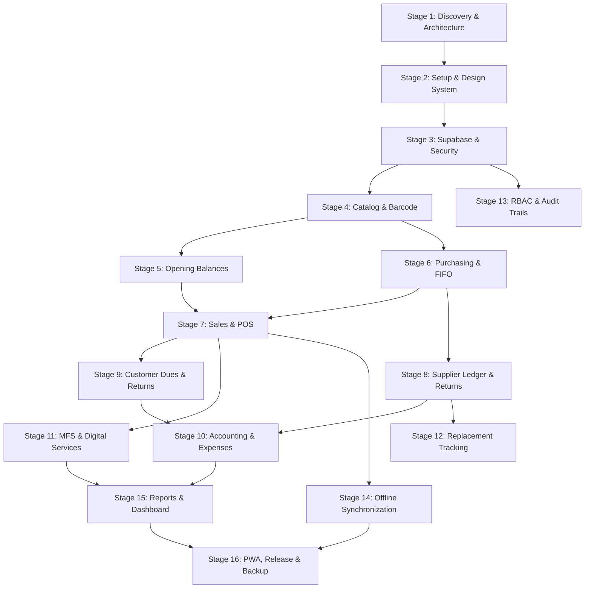

# IMPLEMENTATION ROADMAP & ENGINEERING PHASES
**System Name:** Ruphaidah Shop Management System (RSMS)  
**Document Version:** 1.0.0  
**Status:** Approved for Implementation Planning  
**Execution Methodology:** 16-Stage Iterative Architectural Delivery  

---

## Roadmap Overview & Dependency Graph

---

## Detailed Stage-by-Stage Specifications

### Stage 1: Repository Discovery and Architecture Planning (Current Stage)
- **Scope:** Repository inspection, architectural blueprinting, requirements elicitation, database domain modeling, security threat modeling, and roadmap definition.
- **Prerequisites:** Clean Git repository, business context documentation.
- **Deliverables:**
  - `docs/PROJECT_CHARTER.md`
  - `docs/SYSTEM_ARCHITECTURE.md`
  - `docs/DATABASE_DESIGN.md`
  - `docs/IMPLEMENTATION_ROADMAP.md`
  - `docs/SECURITY_AND_TEST_PLAN.md`
  - `docs/OPEN_QUESTIONS.md`
- **Dependencies:** None.
- **Risks:** Scope creep; over-engineering initial single-shop deployment.
- **Test Plan:** Static documentation review against all prompt constraints and business domain invariants.
- **Acceptance Criteria:** All 6 planning documents committed to Git; no premature code or packages installed.
- **Explicitly Excluded Work:** Application coding, dependency installation, database migration creation.

---

### Stage 2: Project Setup and Design System
- **Scope:** Initialize Vite + React 19 + TypeScript template; configure Tailwind CSS with custom retail color palette (emerald/amber/slate) and high-contrast typography; setup Lucide icons, responsive layout shell (desktop POS view, tablet layout, mobile navigation).
- **Prerequisites:** Stage 1 completion and sign-off.
- **Deliverables:**
  - `package.json` with pinned versions (`vite`, `react`, `react-dom`, `tailwindcss`, `lucide-react`, `clsx`, `tailwind-merge`).
  - `tailwind.config.js` with BDT typography and high-density POS sizing tokens.
  - Core UI component primitives: `Button`, `Input`, `Modal`, `DataTable`, `Badge`, `Card`, `Tabs`.
  - App Shell: Collapsible sidebar, top bar with shop status badge, shift indicator, and quick-action bar.
- **Dependencies:** Stage 1.
- **Risks:** Bulky component libraries that slow down initial bundle load.
- **Test Plan:** Vite build verification (`npm run build`), TypeScript compilation check (`tsc --noEmit`), responsive layout visual test across 1080p, 768px, and 375px viewports.
- **Acceptance Criteria:** Fast zero-error dev server start (`npm run dev`), bundle size < 200KB gzipped, crisp rendering on both desktop and mobile.
- **Explicitly Excluded Work:** Backend API connections, state management logic, actual POS business transactions.

---

### Stage 3: Supabase Foundation and Security
- **Scope:** Supabase client initialization; auth configuration; multi-tenant core schema (`shops`, `profiles`, `shop_members`, `audit_logs`); baseline RLS helper functions (`is_shop_owner`, `is_shop_staff`); initial shop creation RPC (`register_shop_and_owner`).
- **Prerequisites:** Stage 2 completion; active Supabase project credentials.
- **Deliverables:**
  - `src/lib/supabase.ts` (Typed Supabase client with publishable key).
  - Migration: `shops`, `profiles`, `shop_members`, `audit_logs` tables with strict RLS enabled.
  - Auth context and route guards (`ProtectedRoute`, `OwnerOnlyRoute`).
  - Onboarding and login screens.
- **Dependencies:** Stage 2.
- **Risks:** Accidentally leaking `service_role` key in frontend code; RLS misconfiguration allowing cross-tenant row leaks.
- **Test Plan:** Automated RLS tests verifying that User A cannot read Shop B's records; test that public sign-up cannot assign itself Owner role of an existing shop.
- **Acceptance Criteria:** Secure login, token refresh, shop tenant scoping on all queries, 100% RLS coverage on created tables.
- **Explicitly Excluded Work:** Product or inventory schemas.

---

### Stage 4: Product Catalog and Barcode Management
- **Scope:** Categories, brands, product catalog, barcode dictionary, and physical unit tracking schemas; UI for catalog management, manufacturer barcode capture, internal barcode generation (`RS-XXXXXX`), and duplicate barcode detection.
- **Prerequisites:** Stage 3.
- **Deliverables:**
  - Database schema for `categories`, `brands`, `products`, `product_barcodes`, `product_units`.
  - Stored procedure for collision-free barcode lookup and unit identification.
  - UI: Product Master table, Category/Brand modals, Barcode generator utility, Barcode scanner listener hook (`useBarcodeScanner`).
- **Dependencies:** Stage 3.
- **Risks:** Re-generating an internal barcode for an item that already has a manufacturer barcode; forcing serial numbers on bulk stationery.
- **Test Plan:**
  - Scan existing manufacturer EAN-13: verify item is selected without creating duplicate product.
  - Add product without barcode: verify auto-generated `RS-XXXXXX` barcode prints correctly.
  - Test bulk stationery item: verify that pens can be added with zero serial prompt.
- **Acceptance Criteria:** Fast barcode search (< 50ms); zero duplicate barcodes per shop; clear distinction between catalog SKU and physical serial/IMEI.
- **Explicitly Excluded Work:** Inventory quantity deductions, purchasing, POS cart.

---

### Stage 5: Opening Stock and Opening Balances
- **Scope:** System initialization module for Day-Zero onboarding: entering existing shop cash, bank balances, MFS wallet floats, customer receivables, supplier payables, and physical opening stock.
- **Prerequisites:** Stage 4.
- **Deliverables:**
  - Tables: `opening_balance_batches`, `opening_stock_items`.
  - RPC: `post_opening_balances(...)` creating opening `fifo_cost_layers` with `source_type = 'opening_stock'` and balancing against `Opening Equity`.
  - UI: Opening Balance Wizard with spreadsheet-style bulk entry for products and balances.
- **Dependencies:** Stage 4.
- **Risks:** Inadvertently posting opening stock as a supplier purchase, creating false supplier liabilities.
- **Test Plan:** Verify that posting 100,000 BDT opening stock creates FIFO layers with zero supplier payable; verify that trial balance balances (`Assets = Equity`).
- **Acceptance Criteria:** Batch finalization locks opening stock against further edits; inventory valuation matches imported opening costs.
- **Explicitly Excluded Work:** Supplier purchase orders, active POS checkout.

---

### Stage 6: Purchasing and FIFO Inventory Management
- **Scope:** Supplier directory, purchase orders (PO), goods receiving notes (GRN), and FIFO cost layer generation; low-stock alert thresholds.
- **Prerequisites:** Stage 4.
- **Deliverables:**
  - Tables: `suppliers`, `purchases`, `purchase_items`, `goods_receipts`, `fifo_cost_layers`, `stock_movements`.
  - Transactional RPC: `receive_purchase_goods(purchase_id, items, ...)` creating FIFO layers atomically upon verified receiving.
  - UI: Supplier Directory, Purchase Order Builder, Goods Receiving screen with batch unit cost inputs.
- **Dependencies:** Stage 4.
- **Risks:** Increasing available stock when a PO is placed rather than when goods are physically received.
- **Test Plan:**
  - Create PO: verify stock count does NOT increase.
  - Receive PO partially: verify only received items increase stock and create FIFO layers.
- **Acceptance Criteria:** Purchasing creates exact FIFO cost layers with correct unit costs; supplier payable balance updates upon goods receipt.
- **Explicitly Excluded Work:** Customer sales, POS checkout.

---

### Stage 7: Sales and Point of Sale (POS)
- **Scope:** Fast cashier POS interface; keyboard shortcuts; barcode scan-to-cart; discount rules; split payment tenders (Cash, MFS, Customer Credit); atomic `post_sale` RPC consuming FIFO layers and recording COGS.
- **Prerequisites:** Stage 5 and Stage 6.
- **Deliverables:**
  - Tables: `customers`, `sales`, `sale_items`, `sale_item_fifo_allocations`, `sale_payments`.
  - Transactional RPC: `post_sale(...)` with `SELECT ... FOR UPDATE` locking on inventory and FIFO layers.
  - UI: High-speed POS Counter, Numeric keypad modal, Split payment modal, ESC/POS thermal receipt printing layout (80mm / 58mm).
- **Dependencies:** Stage 5, Stage 6.
- **Risks:** Race conditions under simultaneous checkout; incorrect COGS calculation when stock spans multiple purchase batches.
- **Test Plan:** Concurrent checkout test: simulate two simultaneous sales of the same limited-stock item; verify exact FIFO layer depletion and zero over-allocation.
- **Acceptance Criteria:** Local cart interaction < 50ms, online checkout round-trip verified against measurable benchmark targets under defined test network conditions; thermal receipt prints with correct invoice number and tax/discount breakdown.
- **Explicitly Excluded Work:** Customer returns, warranty claims, offline sync.

---

### Stage 8: Supplier Ledger and Supplier Returns/Exchanges
- **Scope:** Supplier statement of account; purchase returns; supplier payments; complex supplier exchanges (defective Product A returned and replaced by vendor with Product B).
- **Prerequisites:** Stage 6.
- **Deliverables:**
  - Tables: `supplier_ledger_entries`, `purchase_returns`, `supplier_exchanges`.
  - RPC: `post_supplier_exchange(...)` handling inventory in/out and differential financial credit/debit.
  - UI: Supplier Ledger & Payment screen, Purchase Return modal, Supplier Exchange reconciliation tool.
- **Dependencies:** Stage 6.
- **Risks:** Double-counting inventory returns or prematurely crediting supplier accounts.
- **Test Plan:** Perform exchange of 10x Item A (Cost 100 BDT) for 8x Item B (Cost 150 BDT); verify net financial adjustment of +200 BDT to supplier payable and correct stock movements.
- **Acceptance Criteria:** Supplier running balance accurately tracks all invoices, payments, credits, and exchange differentials.
- **Explicitly Excluded Work:** Customer warranty intake (Stage 9/12).

---

### Stage 9: Customer Dues, Returns, and Warranty Intake
- **Scope:** Customer credit ledger ("Baki" tracking); credit collections; sale returns and refunds (linked to original invoice); initial warranty intake ticketing.
- **Prerequisites:** Stage 7.
- **Deliverables:**
  - Tables: `customer_ledger_entries`, `sale_returns`, `sale_return_items`, `warranty_cases` (intake).
  - RPC: `post_sale_return(...)` returning items to stock and refunding cash or reducing customer due.
  - UI: Customer Directory with credit balance statements, Sale Return modal (scanning original receipt barcode), Warranty Intake slip printer.
- **Dependencies:** Stage 7.
- **Risks:** Accepting a return for an item never sold, or refunding more than the original purchase price.
- **Test Plan:** Return 1 item from an invoice of 3 items: verify original sale status updates to `returned_partial`, customer due balance decreases, and stock is returned with restock movement.
- **Acceptance Criteria:** Zero orphaned customer dues; customer return receipt prints with remaining balance.
- **Explicitly Excluded Work:** Supplier service-center handover tracking (Stage 12).

---

### Stage 10: Accounting and Operating Expenses
- **Scope:** Chart of accounts; cash drawer and bank accounts; daily operating expenses (rent, electricity, paper, tea, salaries); double-entry journal postings; gross vs. net profit calculation.
- **Prerequisites:** Stage 7, Stage 8, Stage 9.
- **Deliverables:**
  - Tables: `financial_accounts`, `journal_entries`, `journal_lines`, `expenses`.
  - RPC: `post_journal_entry(...)` enforcing `SUM(debit) == SUM(credit)`.
  - UI: Expense Entry modal with category breakdown, Chart of Accounts overview, Cash Drawer shift open/close reconciliation.
- **Dependencies:** Stage 7, 8, 9.
- **Risks:** Unbalanced journal entries; confusing expense payouts with supplier inventory payments.
- **Test Plan:** End-of-day shift close: verify physical cash count matches `(Opening Cash + Cash Sales + MFS Cash Out - MFS Cash In - Expenses - Supplier Payments)`.
- **Acceptance Criteria:** Balanced double-entry ledger; clean separation between Cost of Goods Sold and Operating Expenses.
- **Explicitly Excluded Work:** MFS transactions (handled in Stage 11).

---

### Stage 11: Mobile Financial Services (MFS) and Digital Services
- **Scope:** MFS wallet float management (bKash, Nagad, Rocket, Flexiload); customer Cash In / Cash Out / Send Money entry; commission calculation slabs; daily digital services (photocopy, printing, online applications); daily MFS float reconciliation.
- **Prerequisites:** Stage 7, Stage 10.
- **Deliverables:**
  - Tables: `mfs_wallets`, `mfs_transactions`, `mfs_daily_reconciliations`, `digital_service_jobs`.
  - RPC: `post_mfs_transaction(...)` enforcing that principal is float movement while commission is revenue.
  - UI: Rapid MFS Counter screen, Float status widget in top bar, Daily Reconciliation worksheet.
- **Dependencies:** Stage 7, 10.
- **Risks:** **CRITICAL:** Treating customer Cash In/Out principal as shop sales revenue.
- **Test Plan:**
  - Execute 5,000 BDT bKash Cash In: verify Counter Cash increases by 5,000, bKash Float decreases by 5,000, and Revenue increases ONLY by 20.50 BDT commission.
- **Acceptance Criteria:** 100% adherence to MFS accounting invariants; zero drift between system float and actual SIM float.
- **Explicitly Excluded Work:** Automated SIM SMS scraping (manual entry only).

---

### Stage 12: Service-Center Replacement Tracking
- **Scope:** End-to-end lifecycle for defective goods handed over to suppliers or external service centers; tracking handover dates, expected return dates, courier tracking, vendor follow-up reminders, and resolution outcomes (new unit replacement, repaired unit return, credit note, rejection).
- **Prerequisites:** Stage 8, Stage 9.
- **Deliverables:**
  - Tables: `service_handovers`, `warranty_resolutions`.
  - UI: Warranty Pipeline Kanban board (Intake -> Handed Over -> At Service Center -> Ready for Customer -> Closed), Overdue follow-up alert badges.
- **Dependencies:** Stage 8, 9.
- **Risks:** Handing a product to a supplier and mistakenly deducting supplier debt immediately.
- **Test Plan:** Hand over 5 defective power banks to supplier: verify supplier payable is untouched; resolve 3 with replacement units and 2 with credit notes; verify inventory and financial entries post only upon resolution.
- **Acceptance Criteria:** Complete visibility into every pending warranty item; zero lost items at service centers.
- **Explicitly Excluded Work:** Direct hardware repair logging (external repairs only).

---

### Stage 13: Owner/Staff Permissions and Audit Trails
- **Scope:** Fine-grained authorization; field-level masking (masking cost price and supplier details from staff); sensitive action logging (price edits, manual stock adjustments, voids); audit log inspection interface.
- **Prerequisites:** Stage 3 through 12.
- **Deliverables:**
  - Database views and RPCs with role-based masking.
  - RLS policy refinement for `staff` vs `owner`.
  - UI: Employee Management screen, Permission Toggle matrix, Audit Log Explorer with state diff view.
- **Dependencies:** Stage 3.
- **Risks:** Staff discovering unmasked RPC endpoints that return wholesale purchase costs.
- **Test Plan:** Log in as `staff`: attempt to query `purchases` and `fifo_cost_layers` via PostgREST; verify 403 Forbidden or nullified cost fields.
- **Acceptance Criteria:** Complete tenant and role isolation; every sensitive edit logs actor, timestamp, and previous values.
- **Explicitly Excluded Work:** Public user self-registration.

---

### Stage 14: Offline Synchronization (IndexedDB / Dexie.js)
- **Scope:** Client-side caching of products, customers, and active prices; mutation outbox queue; offline POS sale processing; background sync engine upon network reconnection; idempotent server RPC `sync_client_mutations`.
- **Prerequisites:** Stage 7, Stage 11.
- **Deliverables:**
  - `src/lib/dexie.ts` (IndexedDB schema and outbox manager).
  - Background Sync Worker and online/offline event listener.
  - RPC: `sync_client_mutations(mutations_batch)` with idempotency deduplication and conflict logging.
  - UI: Network connectivity pill indicator, Sync Outbox drawer with retry triggers.
- **Dependencies:** Stage 7.
- **Risks:** Data loss during browser crash while offline; concurrent overselling on multiple offline terminals.
- **Test Plan:**
  - Disconnect Wi-Fi: complete 5 sales in POS; verify offline receipts print.
  - Reconnect Wi-Fi: verify all 5 sales post to Supabase with original timestamps, stock deducts correctly, and outbox empties.
- **Acceptance Criteria:** Zero duplicate transactions; clear visual conflict indicator if physical stock was overdrawn.
- **Explicitly Excluded Work:** Full offline purchasing or supplier ledger adjustments (POS sales and MFS only).

---

### Stage 15: Dashboard, Reports, and Business Intelligence
- **Scope:** Executive reporting; daily sales & gross margin (FIFO based); MFS commission summaries; low stock alerts; customer due aging; supplier payable schedule; export to Excel / PDF.
- **Prerequisites:** Stages 7 through 14.
- **Deliverables:**
  - SQL aggregate views for fast reporting.
  - UI: Executive Dashboard, Daily Sales Report, FIFO Margin Analysis, Stock Valuation Statement, Customer Baki Report, MFS Ledger Summary.
  - Print & Export utilities (CSV, Excel, formatted PDF).
- **Dependencies:** Stages 7, 8, 10, 11.
- **Risks:** Heavy analytical queries locking production OLTP tables during daytime sales rushes.
- **Test Plan:** Run daily sales report over 10,000 simulated sales records; verify query execution time < 250ms.
- **Acceptance Criteria:** Instant, accurate reporting; net profit accurately subtracts expenses and COGS from gross revenues.
- **Explicitly Excluded Work:** External BI tooling (Metabase/PowerBI) integrations.

---

### Stage 16: PWA, Deployment, Backup, and Production Release
- **Scope:** Web Manifest, Service Worker caching strategies (`CacheFirst` for static assets, `NetworkOnly` for transactional APIs), offline fallback page, automated backup scripts, production deployment verification.
- **Prerequisites:** All previous stages (1-15).
- **Deliverables:**
  - `manifest.json` and custom app icons for home screen installation.
  - Workbox / Vite PWA plugin configuration.
  - Production build pipeline (`npm run build`).
  - Automated database backup verification protocol (PITR and local encrypted export).
  - Final Production Readiness Sign-Off Report.
- **Dependencies:** Stages 1-15.
- **Risks:** Service worker stale cache serving outdated application code after deployment.
- **Test Plan:** Lighthouse PWA audit (score > 90); simulate complete server migration from backup file.
- **Acceptance Criteria:** App installable on Windows, Android, and iOS; full offline boot capability; verified restorable backups.
- **Explicitly Excluded Work:** Native Android APK compilation (future Capacitor roadmap).
