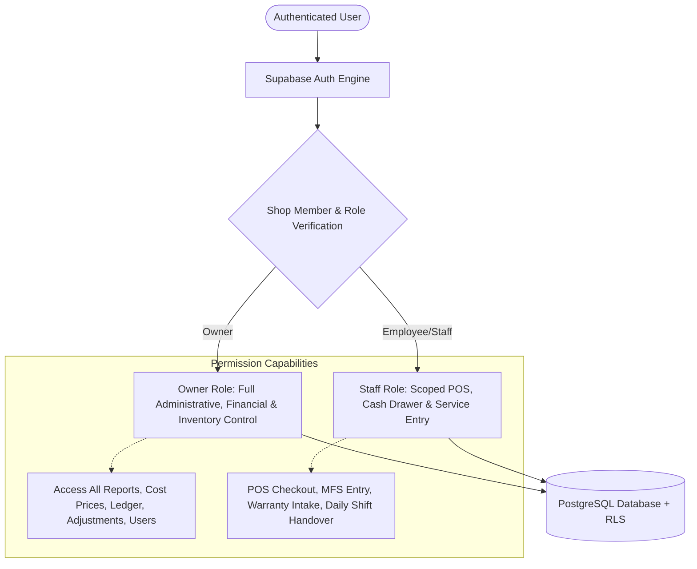

# PROJECT CHARTER — SHOP MANAGEMENT SYSTEM (RUPHAIDAH SHOP)
**Document Version:** 1.0.0  
**Status:** Approved for Implementation Planning  
**Target Environment:** Retail & Digital Services Shop (Bangladesh)  
**System Name:** Ruphaidah Shop Management System (RSMS)  
**Time Zone:** Asia/Dhaka (`UTC+06:00`)  
**Base Currency:** Bangladeshi Taka (BDT, ৳)  

---

## 1. Executive Summary & Product Vision

### 1.1 Product Vision
To build a resilient, high-speed, and secure Point of Sale (POS), Inventory Control, Digital Services, and Double-Entry Accounting platform tailored specifically to the operational realities of retail and digital-service micro-enterprises in Bangladesh. 

Unlike generic e-commerce templates or simple cashbook applications, the Ruphaidah Shop Management System (RSMS) bridges physical hardware accessories, bulk educational stationery, telco digital services (SIM/Recharge/Scratch cards), Mobile Financial Services (bKash, Nagad, Rocket), and service-center warranty tracking into a unified, audit-proof single pane of glass.

### 1.2 The Core Operational Problem
Small-to-medium retail shops in Bangladesh that blend physical merchandise with digital and MFS services suffer from acute operational leakage:
1. **MFS Revenue Conflation:** Shop owners frequently confuse MFS transaction float (custodial capital transferred to/from customers) with business revenue, disguising cash flow deficits and corrupting tax/profit metrics.
2. **Serial & Barcode Friction:** Systems either force every item (even a 5 BDT pen) to have a unique serial number or fail to track warranty serials/IMEIs for expensive electronic accessories.
3. **Warranty & Replacement Black Holes:** Defective accessories handed over to suppliers/distributors get lost in paper notebooks. Shops prematurely deduct supplier debt or forfeit warranty replacements due to lack of due-date follow-ups.
4. **Connectivity Instability:** High reliance on cloud servers causes POS checkout lines to stall during frequent broadband/cellular fluctuations.
5. **Credit & Customer Ledger Disputes:** Informal credit ("Baki") to local customers lacks receipt trails, balance reconciliation, and payment allocation controls.

RSMS eliminates these failure modes through rigorous data invariants, offline-capable POS architecture, strict FIFO inventory valuation, and dedicated digital service accounting.

---

## 2. Business Context & Operating Profile

### 2.1 The Business Entity: Ruphaidah Shop
Ruphaidah Shop is an active commercial retail and customer-service enterprise located in Bangladesh. The operation combines high-turnover low-ticket physical goods, high-value electronics accessories, customized digital services, and financial agency float operations.

### 2.2 Product & Service Line Breakdown
The system natively supports seven distinct operational verticals:

| Vertical | Business Characteristics | Inventory & Tracking Demands | Revenue / Margin Mechanics |
| :--- | :--- | :--- | :--- |
| **1. Mobile Accessories** | Chargers, cables, earphones, power banks, adapters, tempered glass, back covers, phone holders. | Manufacturer barcode or generated internal barcode. Specific high-value items require IMEI/Serial capture; fast-moving accessories track batch & warranty period. | Standard retail margin (Cost vs. Selling Price). FIFO inventory cost allocation. |
| **2. Mobile Financial Services (MFS)** | bKash, Nagad, Rocket, Upay agent and merchant transactions (Cash In, Cash Out, Send Money, Bill Pay). | **Zero physical inventory.** Tracked as liquid float across dedicated MFS asset wallets. | **Principal is strictly custodial.** Income is limited to agent commission and authorized customer service fees. |
| **3. Mobile Recharge / EasyLoad** | Flexiload (Grameenphone), Airtel/Robi Recharge, Banglalink, Teletalk airtime and data packs. | Tracked as balance deductions from SIM balances or master recharge apps. | Commission-based revenue or bulk discount margin upon float purchase. |
| **4. SIM Sales & Replacement** | New biometric SIM cards, SIM replacements (Swap), roaming activations. | Physical SIM cards tracked by ICCID/Serial and mobile number. Biometric registration status tracked. | Fixed activation commission plus SIM card unit margin. |
| **5. Scratch Cards** | Physical telco talk-time and internet scratch vouchers (e.g., 20 BDT, 50 BDT, 100 BDT). | Tracked as physical serial-numbered unit inventory or sealed pack batches. | Fixed unit purchase cost vs. fixed face-value retail price. |
| **6. Educational Stationery** | Pens, pencils, notebooks, geometry boxes, calculators, files, craft paper (excluding textbooks). | High-volume bulk units. Barcode scanning where available; quick-key touch POS for un-barcoded pens/stationery. **No per-pen serial numbers.** | Retail unit margin. Multi-pack and single-unit conversions (e.g., box of 20 pens sold individually). |
| **7. Digital & Studio Services** | Online applications (government/jobs/universities/visa), studio photography, passport photos, photocopy, printing, document laminating. | Consumable tracking (photo paper, A4 paper, toner/ink cartridges, lamination foils). | Pure service revenue minus direct consumable job costing. |

---

## 3. Goals and Non-Goals

### 3.1 Project Goals
1. **Audit-Proof Operational Ledger:** Deliver an immutable, append-only transaction ledger where posted sales, purchases, and cash flows cannot be silently edited or deleted.
2. **True FIFO Inventory Costing:** Track purchase cost layers (`batch_number`, `unit_cost`, `remaining_quantity`) to calculate accurate Cost of Goods Sold (COGS) and gross margin in real-time.
3. **Separation of MFS Principal and Commission:** Enforce database-level distinction between customer cash deposits/withdrawals and the shop's earned commission.
4. **Barcode & Unit Intelligence:** Read existing manufacturer 1D/2D barcodes (EAN-13, UPC, Code 128, QR). Generate internal barcodes only when missing. Support optional IMEI/Serial tracking only where physical hardware requires it.
5. **Supplier Replacement Lifecycle Management:** Manage the entire lifecycle of customer warranty claims, supplier handovers, vendor tracking, and replacement/credit outcomes without premature financial write-downs.
6. **Robust Offline Checkout:** Enable fast POS checkout and receipt printing even during internet outages using local IndexedDB storage, queuing mutations with UUID idempotency keys for reliable background sync.
7. **Multi-Tenant Foundation:** Build single-shop first with strict `shop_id` tenant isolation across all schema tables and RLS policies, ensuring zero architectural friction when scaling to multiple branches or independent tenants later.
8. **Bangladeshi Localization:** Native support for BDT (৳), English and Bengali text search/receipts, and Asia/Dhaka time zone formatting.

### 3.2 Non-Goals (Explicit Exclusions for Initial Release)
1. **Public Customer-Facing E-Commerce:** This project is strictly an in-shop POS, back-office, and inventory ERP. It is not an online public shopping cart.
2. **Textbook Publishing / ISBN Library Management:** School and college textbooks are explicitly excluded; only general stationery is supported.
3. **Automated Telco/MFS API Scraping:** No unofficial scraping, SMS gateway interceptors, or reverse-engineered private bank APIs will be used. All MFS transactions are entered manually or via verified operator SMS confirmations to avoid bank account suspensions.
4. **Multi-Branch Warehouse Distributed Routing (Phase 1):** The initial deployment manages one primary retail shop with one primary stock location. Multi-warehouse automated routing is planned for future phases.
5. **Native Android APK Compilation (Step 1-15):** The system will first be delivered as an installable, high-performance Progressive Web App (PWA). Native Android builds (Capacitor/React Native) are a post-stabilization milestone.

---

## 4. User Roles and Security Boundaries

The system enforces strict Role-Based Access Control (RBAC) backed by PostgreSQL Row Level Security (RLS) and server-side RPC validation:

### 4.1 Role Definitions

#### A. Shop Owner (`role: owner`)
- **Profile:** Business proprietor with ultimate administrative, operational, and legal liability.
- **Access Scope:**
  - Full visibility into purchase costs, supplier liabilities, FIFO margins, net profits, and tax/audit logs.
  - Authorization to post opening balances, inventory write-offs, supplier returns, and manual ledger adjustments.
  - Creation, suspension, and role configuration of employee accounts.
  - Management of shop configuration, tax settings, receipt templates, and external backup exports.

#### B. Shop Employee / Staff (`role: staff`)
- **Profile:** Counter clerk, cashier, or digital service operator.
- **Access Scope:**
  - Fast POS sales, customer search, receipt generation, and cash/MFS payment intake.
  - MFS transaction entry and end-of-shift cash drawer balance reconciliation.
  - Customer warranty intake (logging defective items and issuing claim tickets).
  - Search inventory availability and selling price (purchase cost and supplier identity are masked unless explicitly delegated).
  - **Forbidden:** Deleting or voiding posted transactions without Owner authorization, editing historical supplier balances, altering system configuration, or viewing net profit statements.

### 4.2 Security & Tenant Invariants
- **No Client-Only Security:** Visibility toggles in the React UI are purely for ergonomics; every mutation and read is gated by PostgreSQL RLS and transactional stored procedures.
- **Isolated Tenant Context:** Every database entity references `shop_id`. Queries execute in the scope of the authenticated user's active shop membership.
- **Protection Against Self-Privilege Escalation:** Public registration does not grant Owner status to any existing shop. Shop creation is an explicit, transactional onboarding flow that registers a new tenant and sets the caller as Owner.

---

## 5. Platform Scope & Technology Profile

- **Target Form Factors:** 
  - Desktop / Laptop (Primary checkout and back-office management, 1080p / 1366x768).
  - Tablet (POS counter and inventory audit, iPad / Android 10"+).
  - Smartphone (Owner on-the-go monitoring and mobile barcode scanning, responsive mobile layout).
- **Client Stack:** React 19 + TypeScript, Vite build tool, Tailwind CSS design system, Lucide icons.
- **State & Offline Storage:** Dexie.js (IndexedDB wrapper) for client caching, offline sales queue, and barcode dictionary.
- **Backend Infrastructure:** Supabase (PostgreSQL 15+, Supabase Auth, Row Level Security, pg_cron, Realtime).
- **Printer & Peripheral Support:**
  - 80mm & 58mm Thermal Receipt Printers (ESC/POS compatible via Web USB / Web Serial or standard browser print dialog).
  - USB / Bluetooth 1D/2D Barcode Scanners (acting as standard HID keyboard input or camera-based scanning via `html5-qrcode`).
- **Network Resilience:** Progressive Web App (PWA) with Service Worker caching of static assets and client-side mutation queues for seamless offline sales.

---

## 6. Functional Requirements Overview

### FR-01: Product Catalog & Barcode Identity
- Support multi-level categories, brands, product variants, and tax classes.
- Store primary manufacturer barcode (EAN-13, UPC, Code 128, QR).
- Auto-generate collision-free internal barcodes (format `RS-XXXXXX`) only when no manufacturer code is present.
- Support physical unit tracking: differentiate Product SKU from individual Unit ID (IMEI/Serial) for serialized items.
- Bulk goods management: allow units-of-measure (Piece, Box, Packet, Dozen, Kilogram) with fractional conversion.

### FR-02: Inventory & Purchasing (FIFO)
- Opening stock recording with explicit unit costs, batch references, and historical valuation.
- Multi-status inventory tracking: `available`, `reserved` (pending delivery/layaway), `defective` (in-shop), `service_center` (handed to vendor), `disposed` (written off).
- Supplier purchase order lifecycle: Draft -> Ordered -> Received. **Inventory increments only upon confirmed Goods Receiving.**
- FIFO cost layers created automatically upon goods receipt.
- Stock adjustments with mandatory reason codes (`damage`, `expiry`, `theft`, `reconciliation_count`) and audit links.

### FR-03: Point of Sale (POS) & Customer Receivables
- High-speed checkout (< 3 seconds per transaction on typical 3-item cart).
- Keyboard-first shortcuts for cashier speed (F2 for search, F4 for payment, Space to complete).
- Split payment support (e.g., partial Cash + partial bKash + partial Credit).
- Customer ledger ("Baki" management): track credit limits, previous dues, running balance, and receipt prints.
- Instant receipt printing with bilingual header/footer (Bangla & English).

### FR-04: Supplier Ledger, Warranty & Replacement
- Running supplier balance ledger (Purchases, Payments, Credits, Debits).
- Warranty claims intake from customers with automated due-date scheduling.
- Supplier handover workflow: record handed-over serialized items, expected resolution date, courier/delivery note.
- Resolution handling: replacement unit (same or different SKU), repaired unit return, credit note, or rejection.
- **Zero auto-credit invariant:** Vendor handover does not credit supplier account until resolution is officially concluded.

### FR-05: MFS & Digital Services Management
- Multi-provider wallet balances (bKash Agent, bKash Merchant, Nagad Agent, Rocket Agent, Flexiload SIMs).
- Custodial balance ledger: Customer Cash In (Cash Received +, MFS Float -), Customer Cash Out (MFS Float +, Cash Disbursed -).
- Automated commission calculation based on carrier slabs (e.g., 4.10 BDT per 1000 BDT cash out).
- Daily digital services reconciliation (Physical Cash vs. MFS Float vs. Expected Daily Commission).
- Digital service job tracking (Photocopy count, printing jobs, online application reference numbers).

### FR-06: Integrated Financial Ledger & Reporting
- Double-entry transaction ledger: Assets = Liabilities + Equity + (Revenue - Expenses).
- Expense tracking by operational category (Shop Rent, Utility bills, Paper/Toner, Salaries, Refreshments).
- Daily Sales & Gross Profit Report (using true FIFO cost layer matching).
- Balance Sheet and Cash/Bank/MFS Liquidity statement.
- Customer due aging report and supplier payable schedules.

---

## 7. Non-Functional Requirements

| Metric / Dimension | Specification | Verification Method |
| :--- | :--- | :--- |
| **Response Latency** | POS barcode scan-to-cart < 50ms local; Sale commit < 50ms (local outbox) / < 400ms target online round-trip under defined benchmark conditions (< 50ms RTT to DB). | Automated performance benchmark suite under defined hardware and network conditions. |
| **Data Integrity** | Zero floating-point rounding errors on currency. All money stored as `NUMERIC(15, 2)` or `NUMERIC(18, 4)`. | Database constraint audit. |
| **Offline Resilience** | Full POS functionality retains operational capability for at least 72 hours of complete disconnection. | Network blackout simulation. |
| **Concurrency** | Row-level locking (`FOR UPDATE`) on inventory and FIFO layers prevents duplicate stock consumption. | Concurrent POS stress testing. |
| **Auditability** | Every mutation logs timestamp, executing user ID, IP/client info, and state diff. | Audit trail inspection. |
| **Browser Compatibility**| Modern Chromium (Chrome, Edge, Brave), Firefox, and Safari on desktop and mobile. | Cross-browser automated test suite. |

---

## 8. Assumptions & Project Constraints

1. **Connectivity Model:** The shop has broadband Wi-Fi supplemented by cellular 4G mobile hotspot. Brief outages (minutes to hours) occur weekly; extended outages (load shedding / cable cuts) occur occasionally.
2. **Hardware Constraints:** Primary checkout PC is a Windows desktop or laptop. Secondary input may be an Android tablet or smartphone.
3. **Receipt Formats:** ESC/POS standard thermal printers (80mm and 58mm) using standard roll paper.
4. **Legal & Tax Context:** Standard trade license operations under Bangladesh municipal rules. VAT/Tax reporting format needs to align with National Board of Revenue (NBR) retail receipt norms where applicable.
