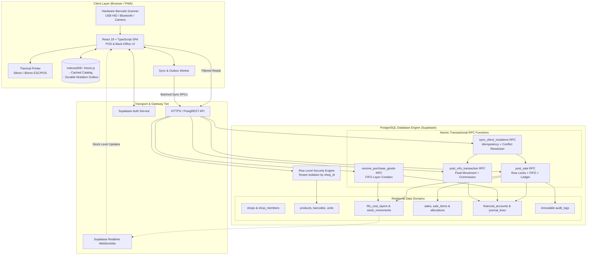
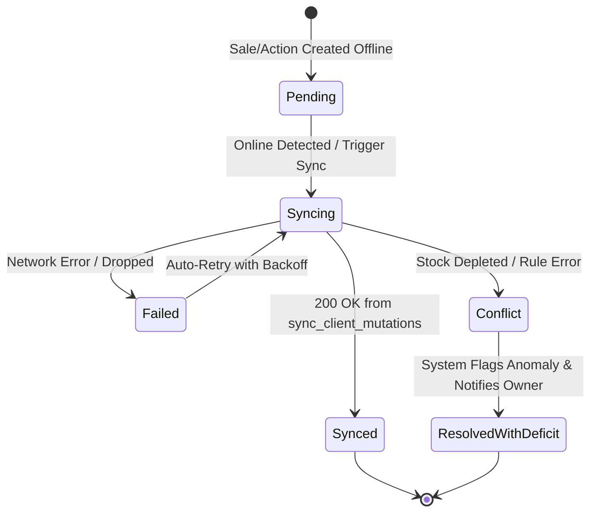

# SYSTEM ARCHITECTURE & TECHNICAL SPECIFICATION
**System Name:** Ruphaidah Shop Management System (RSMS)  
**Document Version:** 2.0.0 (Reviewed & Finalized Architecture Specification)  
**Status:** Approved for Implementation Planning  
**Target Environment:** Retail & Digital Services Shop (Bangladesh)  
**Time Zone:** Asia/Dhaka (`UTC+06:00`)  
**Base Currency:** Bangladeshi Taka (BDT, ৳)  

> [!IMPORTANT]
> **Planning and Architectural Specification Document Only.**  
> This document specifies the proposed system architecture, interface contracts, data flows, and security constraints. No application code, database migrations, package installations, or RPC implementations have been deployed yet.

---

## 1. Purpose and Scope

### 1.1 Purpose
The Ruphaidah Shop Management System (RSMS) is an offline-capable, web-based Retail Point of Sale (POS), Inventory Control, Digital Services, and Double-Entry Accounting platform engineered for a hybrid retail and agency services shop operating in Bangladesh. 

The architecture is designed to handle high-frequency retail transactions, physical serial/IMEI warranty tracking, bulk stationery sales, telco services (SIM registration, talk-time recharge, scratch cards), Mobile Financial Services (MFS: bKash, Nagad, Rocket), and service-center vendor handovers without operational or financial data leakage.

### 1.2 System Scope
- **Core Commerce:** Fast retail POS checkout, barcode scanning, split payments (Cash, MFS, Customer Credit / "Baki"), receipt printing (58mm and 80mm thermal paper).
- **Inventory Engine:** FIFO cost layering, multi-status inventory (`available`, `reserved`, `defective`, `at_service_center`, `sold`, `disposed`), opening stock valuation, purchase receiving, and supplier returns/exchanges.
- **Identity & Traceability:** Product SKU identification, manufacturer barcode scanning, internal barcode generation (`RS-XXXXXX`), and physical unit tracking (IMEI/Serial) strictly for serialized items without forcing serials on bulk stationery.
- **Agency & Digital Services:** MFS float management, Cash In / Cash Out logging with strict custodial float separation from commission revenue, recharge tracking, and digital service job logging (photocopy, printing, online applications, studio photography).
- **Financial Accounting:** Integrated double-entry general ledger, chart of accounts, customer receivables, supplier payables, operating expense tracking, and real-time gross/net margin reporting.
- **Deployment & Form Factors:** Responsive Web Application and installable Progressive Web App (PWA) optimized for desktop PC checkout counters, tablet POS, and mobile Owner monitoring.

---

## 2. Architecture Principles

1. **Offline-First with Server-Enforced Invariants:** The client interface must continue operating during internet outages using local IndexedDB caching and a durable mutation outbox. However, all final business validations, FIFO cost allocations, inventory deductions, and ledger postings are executed within atomic server-side PostgreSQL transactions.
2. **Never Trust the Client:** Client-side checks are for user feedback only. Row Level Security (RLS) and server-side RPC functions validate authentication, permissions, tenant boundaries, stock quantities, and financial balances before committing any mutation.
3. **Strict Multi-Tenant Isolation:** Every business table includes a `shop_id` tenant identifier. Cross-tenant references are prevented using composite foreign keys (`shop_id, parent_id`). RLS policies filter rows by active authenticated membership.
4. **Append-Only Financial & Stock Audit Trails:** Posted sales, purchases, stock movements, and ledger entries are immutable. No hard deletes or silent updates are permitted. Corrections require explicit voiding or reversal transactions with mandatory audit reasons.
5. **Separation of Custodial Float and Revenue:** MFS principal amounts belong to customers or financial institutions and are never credited to sales income. Only earned operator commissions and customer service fees constitute revenue.
6. **Hardware-Agnostic Progressive Enhancement:** Base printing and scanning functionalities rely on universal web standards (`window.print()`, HID keyboard emulation). Direct hardware APIs (Web Serial, WebUSB) and camera scanning serve as progressive enhancements without locking the system into proprietary hardware.
7. **Measurable Performance Engineering:** System latency and checkout speeds are benchmarked under explicit, defined hardware and network conditions rather than unsupported speculative claims.

---

## 3. System Overview and Architecture Diagram

The system operates across three tiers:
1. **Client Tier (Browser / PWA / Hardware Peripherals):** React 19 SPA running in desktop/mobile browsers, managing local UI state, barcode scanner input, thermal receipt formatting, and IndexedDB local storage.
2. **Edge & Transport Tier:** PostgREST HTTPS API and Supabase Realtime WebSockets, routing client requests and background mutation sync batches.
3. **Database Tier (Supabase / PostgreSQL 15+):** Houses relational tables, RLS enforcement, double-entry financial ledger, FIFO cost allocation engine, and atomic transactional RPCs.



---

## 4. Client Runtime and Frontend Modules

### 4.1 Framework & Core Stack
- **Framework:** React 19 with TypeScript under strict mode (`strict: true`, `noImplicitAny: true`, `exactOptionalPropertyTypes: true`).
- **Build Tool:** Vite 6+ utilizing ESM development server and Rollup production bundler.
- **Dependency Versioning Policy:** All third-party packages must be pinned to verified, compatible, actively maintained versions. React 19 compatibility must be verified before dependency installation (specifically auditing `@tanstack/react-query`, `dexie`, `lucide-react`, and printing utilities).
- **Styling System:** Tailwind CSS with a curated retail palette (Emerald for active cash/sales, Amber for dues/warnings, Slate for high-contrast counters). Supports dark mode for evening shifts and high-contrast styling for sunlight-exposed shopfronts.
- **PWA Capabilities:** Web App Manifest and Service Worker providing offline caching of JavaScript bundles, CSS stylesheets, icons, and fonts (`CacheFirst` strategy for static assets, `NetworkOnly` with IndexedDB fallback for API calls).

### 4.2 Frontend Functional Modules
```
src/
├── app/                  # App shell, router guards, theme providers
├── modules/
│   ├── auth/             # Login, session renewal, password reset
│   ├── pos/              # High-speed checkout counter, cart state, quick-keys
│   ├── catalog/          # Products, brands, categories, barcode management
│   ├── inventory/        # Stock levels, FIFO layer inspection, adjustments
│   ├── purchasing/       # Supplier POs, goods receiving, cost inputs
│   ├── mfs/              # bKash/Nagad/Rocket float dashboard, transactions
│   ├── warranty/         # Warranty intake, vendor handover Kanban, follow-ups
│   ├── customers/        # Customer directory, Baki credit statements, payments
│   ├── suppliers/        # Supplier ledger, purchase returns, exchanges
│   ├── accounting/       # Chart of accounts, expenses, daily cash reconciliation
│   └── reports/          # Daily sales, FIFO gross profit, due aging, tax exports
├── lib/
│   ├── supabase.ts       # Typed Supabase client (publishable key only)
│   ├── dexie.ts          # IndexedDB schema and outbox manager
│   ├── scanner.ts        # Barcode scanner listener & input buffer
│   ├── printer/          # ESC/POS formatter, 58mm/80mm receipt templates
│   └── sync.ts           # Background sync orchestrator & conflict handler
└── components/ui/        # Reusable design system primitives
```

### 4.3 High-Speed POS Interface & Performance Targets
- **Keyboard-First Workflow:**
  - `F2`: Instant focus on product search / barcode input.
  - `F4`: Open tender / payment modal.
  - `Space` (in tender modal): Quick-complete exact cash sale.
  - `F8`: Park / suspend current cart.
  - `ESC`: Clear search or close modal.
- **Measurable Checkout Performance Targets:**
  - *Benchmark Conditions:* Standard counter PC (Intel Core i3 / 8GB RAM or equivalent), Chromium browser 120+, USB HID barcode scanner, 100-item local cart in memory, 100Mbps broadband connection with < 50ms ping to Supabase region.
  - *Local POS Interaction Target:* Barcode scan to UI cart addition < 50ms.
  - *Local Offline Outbox Commit:* Sale submission to local IndexedDB commit and receipt generation < 50ms.
  - *Online RPC Commit Target:* Online sale round-trip < 400ms under standard network conditions.  
  *(Note: Checkout latency claims must be measured and validated during Stage 7 testing under defined benchmark conditions).*

### 4.4 Hardware Barcode Scanning Integration
- **Primary Method (USB HID & Bluetooth Scanner):** Scanners emulate a rapid keyboard input. The client runtime implements an event listener on `window.document` that captures keystrokes, calculates inter-keystroke intervals (buffer timeout of 30ms), and recognizes an `Enter` suffix as a complete barcode scan.
- **Fallback Method (Camera-Based Scanner):** For mobile tablets or smartphones lacking USB ports, camera scanning is provided via `html5-qrcode` or `@zxing/library`, with explicit permission handling and torch toggle.

---

## 5. Authentication, Tenant Security and Authorization

### 5.1 Authentication Flow
- User authentication is handled via Supabase Auth using email or verified mobile number and password.
- Authentication tokens (JWT) are signed using RS256/ES256 and expire after 1 hour. Refresh tokens are stored in browser `localStorage` or secure cookie storage.
- **Authorization Rule:** **Never use `user_metadata` for authorization decisions.** User metadata is client-editable. Authorization roles and tenant scopes are stored exclusively in the server-managed `shop_members` table.

### 5.2 Tenant Isolation Architecture
1. **Mandatory Tenant Foreign Key:** Every business record in the database contains `shop_id UUID NOT NULL REFERENCES shops(id) ON DELETE CASCADE`.
2. **Composite Foreign Keys:** Relationships between parent and child records enforce tenant isolation at the foreign key level:
   ```sql
   -- Example: Sale Items to Sales
   FOREIGN KEY (shop_id, sale_id) REFERENCES sales(shop_id, id) ON DELETE CASCADE
   ```
3. **Row Level Security (RLS) Policies:** RLS is enabled on 100% of tables in the `public` schema. Standard read access pattern:
   ```sql
   CREATE POLICY "tenant_isolation_select" ON products
   FOR SELECT TO authenticated
   USING (
     EXISTS (
       SELECT 1 FROM shop_members sm 
       WHERE sm.shop_id = products.shop_id 
         AND sm.user_id = (SELECT auth.uid()) 
         AND sm.is_active = true
     )
   );
   ```
4. **Secure Shop Creation Flow:** Public sign-up cannot assign arbitrary users to the `owner` role of existing shops. The initial creation of a shop and its owner is gated behind the `register_new_shop` stored procedure.

### 5.3 Secret Management & Client Isolation
- **Browser Environment:** The client bundle contains **ONLY** `VITE_SUPABASE_URL` and `VITE_SUPABASE_ANON_KEY` (publishable key).
- **Service-Role Key:** The Supabase `service_role` key carries full administrative privileges and **must never be present in client code, environment files committed to Git, or browser network payloads**.

---

## 6. Database and Data-Access Architecture

### 6.1 Database Engine & Hosting
- Managed PostgreSQL 15+ hosted on Supabase.
- All connections are pooled via Supavisor / PgBouncer to prevent connection exhaustion during concurrent retail checkout spikes.
- Default schema search path is locked: `SET search_path = public;`.

### 6.2 Data Access Patterns
- **PostgREST Read Layer:** Filtered reads (product search, customer directory, report queries) execute via PostgREST using client-side TanStack Query for caching and pagination.
- **Transactional RPC Layer:** Critical business operations that modify inventory, post sales, consume FIFO layers, or write to the financial ledger **must bypass direct table updates** and execute through transactional PostgreSQL stored procedures (`post_sale`, `receive_purchase_goods`, `post_mfs_transaction`, `sync_client_mutations`).
- **Selective Realtime Usage:** Supabase Realtime (WebSockets) is restricted to operational notifications:
  - Inventory quantity changes (broadcasting low-stock alerts across terminals).
  - Background outbox sync completion events.  
  *Realtime is explicitly disabled on high-frequency ledger and audit tables to preserve server resources.*

---

## 7. Transactional RPC Contracts

> [!NOTE]
> The function signatures and behaviors below represent **proposed architectural contracts** for the backend implementation stages. They are not yet implemented in the database.

### 7.1 `post_sale(...)`
- **Purpose:** Atomically posts a completed POS sale, locks and consumes FIFO layers, logs stock movements, creates customer receivables, records payment tenders, and posts double-entry ledger lines.
- **Proposed Signature:**
  ```sql
  FUNCTION post_sale(
    p_shop_id UUID,
    p_sale_payload JSONB,
    p_idempotency_key UUID
  ) RETURNS JSONB;
  ```
- **Execution Safeguards:**
  1. *Authentication & Authorization:* Asserts `auth.uid()` belongs to `shop_id` with `owner` or `staff` role.
  2. *Idempotency Check:* Checks `sync_idempotency_store`. If `p_idempotency_key` exists, immediately returns the previously generated receipt payload.
  3. *Concurrency & Row Locking:* Executes `SELECT id, available_quantity FROM product_inventory WHERE ... FOR UPDATE` and locks eligible `fifo_cost_layers WHERE remaining_quantity > 0 ORDER BY received_at ASC FOR UPDATE`.
  4. *Stock Validation:* Validates that requested quantity does not exceed available stock (unless flagged as offline deficit reconciliation).
  5. *FIFO Allocation:* Depletes the oldest remaining cost layers, computing exact Cost of Goods Sold (COGS).
  6. *Atomic Postings:* Inserts into `sales`, `sale_items`, `sale_item_fifo_allocations`, `sale_payments`, `stock_movements`, and balanced `journal_lines` in a single atomic commit.

### 7.2 `receive_purchase_goods(...)`
- **Purpose:** Records physical intake of ordered goods from a supplier, creates new FIFO cost layers, updates inventory, and adjusts supplier payables.
- **Proposed Signature:**
  ```sql
  FUNCTION receive_purchase_goods(
    p_shop_id UUID,
    p_purchase_id UUID,
    p_receiving_payload JSONB,
    p_idempotency_key UUID
  ) RETURNS JSONB;
  ```
- **Execution Safeguards:**
  1. Validates that `received_quantity <= (ordered_quantity - previously_received_quantity)`.
  2. Creates `goods_receipts` record and appends new records to `fifo_cost_layers` with exact verified unit costs.
  3. Inserts `stock_movements` with `movement_type = 'purchase_receive'`.
  4. Posts double-entry journal entry: Debit `Inventory Asset`, Credit `Supplier Accounts Payable`.

### 7.3 `post_mfs_transaction(...)`
- **Purpose:** Records an MFS agency transaction (Cash In, Cash Out, Send Money, Bill Pay, Recharge) with strict separation of customer principal and earned commission.
- **Proposed Signature:**
  ```sql
  FUNCTION post_mfs_transaction(
    p_shop_id UUID,
    p_wallet_id UUID,
    p_service_type VARCHAR,
    p_customer_phone VARCHAR,
    p_principal_amount NUMERIC,
    p_commission_amount NUMERIC,
    p_service_fee NUMERIC,
    p_trx_id VARCHAR,
    p_idempotency_key UUID
  ) RETURNS JSONB;
  ```
- **Execution Safeguards:**
  1. Validates wallet existence and verifies float balance.
  2. For Cash In: Asserts shop counter cash increases by `principal_amount` while wallet float decreases by `principal_amount`.
  3. For Cash Out: Asserts wallet float increases by `principal_amount` while shop counter cash decreases by `principal_amount`.
  4. **Revenue Integrity:** The `principal_amount` is never credited to revenue. Only `p_commission_amount` and `p_service_fee` are credited to revenue accounts.

### 7.4 `sync_client_mutations(...)`
- **Purpose:** Batch synchronization endpoint for processing queued offline transactions.
- **Proposed Signature:**
  ```sql
  FUNCTION sync_client_mutations(
    p_shop_id UUID,
    p_mutations JSONB[]
  ) RETURNS JSONB;
  ```
- **Execution Safeguards:**
  1. Validates caller session once and processes each mutation envelope in strict chronological order.
  2. Checks each mutation's `client_mutation_id` against the idempotency store.
  3. Executes internal calls to `post_sale`, `post_mfs_transaction`, or warranty intake within isolated sub-transactions (savepoints).
  4. *Conflict Handling:* If an offline sale requests stock that was sold online while disconnected, the sale is recorded, the physical inventory deficit is logged (`stock_reconciliation_deficit`), and an urgent Owner alert is triggered.
  5. Returns a structured JSON array with per-mutation success/failure statuses and server timestamps.

---

## 8. Inventory, Barcode and FIFO Design

### 8.1 Product Identity vs. Physical Unit Identity
- **Product ID (Catalog SKU):** Represents the abstract product type (e.g., "Remax 20W USB-C Charger", "Matador Orbit Ballpoint Pen"). Defines default selling price, category, brand, and unit of measure.
- **Physical Unit ID (Asset Tag / IMEI / Serial):** Represents a specific physical unit instance. 
  - **Serial Number / IMEI Capture Rule:** Serial numbers and IMEIs are captured **only** when the manufacturer physically stamps them on the hardware (e.g., smartphones, Wi-Fi routers, high-value power banks).
  - **Bulk Goods Invariant:** Bulk stationery (pens, pencils, notebooks, erasers) and fast-moving un-serialized cables **must never require manual per-unit serial scanning**. They are tracked purely by aggregate inventory quantity and FIFO batch layers.

### 8.2 Barcode Resolution Engine
- **Primary Rule:** If an item already has a usable manufacturer 1D/2D barcode (EAN-13, UPC-A, Code 128, QR Code), the system records that existing barcode in `product_barcodes`. **It must not generate a redundant internal barcode.**
- **Internal Barcode Generation:** When an item has no manufacturer barcode (e.g., unbranded accessories, bulk stationery sold individually), the system generates a collision-free internal barcode formatted as `RS-XXXXXX` (where `XXXXXX` is a random alphanumeric or sequential check-digit token).
- **Duplicate Barcode Prevention:** A database unique constraint `UNIQUE (shop_id, barcode)` ensures no two products share the same barcode within a shop.

### 8.3 FIFO Cost Layering & Inventory Valuation
1. **Layer Creation:** Each goods intake (`opening_stock`, `goods_receipt`) creates a record in `fifo_cost_layers`:
   - `original_quantity`: Total quantity received in this batch.
   - `remaining_quantity`: Unconsumed quantity currently on hand.
   - `unit_cost`: Exact landed purchase cost per unit (`NUMERIC(18, 4)`).
   - `received_at`: Timestamp determining FIFO consumption priority.
2. **Layer Depletion:** When a sale of $N$ units occurs, the system queries active layers ordered by `received_at ASC, id ASC FOR UPDATE`.
   - If Layer 1 has 5 units @ 100 BDT and the sale is 8 units, Layer 1 is depleted to 0, and Layer 2 is charged for 3 units @ 110 BDT.
   - The exact allocation is persisted in `sale_item_fifo_allocations` to lock in historical Cost of Goods Sold (COGS).
3. **Concurrency Control:** Row locks (`FOR UPDATE`) on both inventory records and FIFO layers prevent concurrent checkout lines from allocating the same batch quantity twice.

### 8.4 Inventory Movement Traceability
Every physical stock change is recorded in the append-only `stock_movements` table with one of the following statuses:
`opening_stock`, `purchase_receive`, `sale_out`, `sale_return_in`, `supplier_return_out`, `adjustment_loss`, `adjustment_gain`, `service_center_out`, `service_center_in`.

---

## 9. Double-Entry Financial Ledger

### 9.1 Core Accounting Principles
- All monetary amounts are stored using PostgreSQL exact numeric types (`NUMERIC(15, 2)` for currency amounts; `NUMERIC(18, 4)` for unit valuations). Floating-point data types (`REAL`, `FLOAT`, `DOUBLE PRECISION`) are strictly forbidden.
- The system enforces double-entry bookkeeping: for every posted transaction, $\sum \text{Debits} = \sum \text{Credits}$.
- No client-side direct inserts or updates to posted journal lines. All postings occur via validated stored procedures.

### 9.2 Chart of Accounts Structure
```
1000 - ASSETS
  ├── 1010 - Main Cash Drawer (Physical Currency)
  ├── 1020 - Bank Accounts (Checking / Savings)
  ├── 1030 - MFS Float Wallets (bKash, Nagad, Rocket Agent Float)
  ├── 1040 - Inventory Asset (Valued at FIFO Cost)
  └── 1050 - Customer Accounts Receivable ("Baki" Customer Dues)
2000 - LIABILITIES
  ├── 2010 - Supplier Accounts Payable (Vendor Debts)
  └── 2020 - Customer Advances / Deposits
3000 - EQUITY
  ├── 3010 - Owner Opening Capital / Equity
  └── 3020 - Retained Earnings
4000 - REVENUE
  ├── 4010 - Merchandise Sales Revenue
  ├── 4020 - MFS Operator Commission Revenue
  └── 4030 - Digital & Studio Service Fees
5000 - COST OF GOODS SOLD (COGS)
  └── 5010 - Merchandise Cost of Goods Sold (FIFO Allocated)
6000 - OPERATING EXPENSES
  ├── 6010 - Shop Rent
  ├── 6020 - Electricity & Utilities
  ├── 6030 - Staff Salaries & Allowances
  ├── 6040 - Consumables (Photo Paper, Toner, Laminating Film)
  └── 6050 - Entertainment & Refreshments
```

### 9.3 Transaction Mapping Examples

| Transaction Type | Debit Account | Credit Account | Rule / Notes |
| :--- | :--- | :--- | :--- |
| **Cash Retail Sale** | `1010 Main Cash Drawer` | `4010 Sales Revenue` | Cash collected at counter. |
| **COGS Allocation** | `5010 Cost of Goods Sold` | `1040 Inventory Asset` | Automatically generated from FIFO layers. |
| **Credit Sale ("Baki")** | `1050 Accounts Receivable` | `4010 Sales Revenue` | Customer due balance increases. |
| **Supplier Goods Intake** | `1040 Inventory Asset` | `2010 Accounts Payable` | Created upon goods receipt; not on PO draft. |
| **Supplier Debt Payment** | `2010 Accounts Payable` | `1010 Cash` or `1020 Bank` | Reduces vendor debt. |
| **bKash Cash In (10k + 41 Fee)** | `1010 Cash (+10,000)` | `1030 bKash Float (-10,000)`<br/>`4020 MFS Commission (+41)` | Principal is custodial float swap; commission is revenue. |
| **Shop Operating Expense** | `6020 Electricity Expense` | `1010 Main Cash Drawer` | Supported by physical receipt voucher. |

### 9.4 Reversal & Correction Workflow
If a completed sale is voided:
1. `void_sale(sale_id, reason)` RPC is executed by an authorized Owner.
2. The sale record transitions to `status = 'voided'`.
3. A compensating reversing journal entry is posted:
   - Debit `4010 Sales Revenue`, Credit `1010 Cash Drawer` (or `1050 Accounts Receivable`).
   - Debit `1040 Inventory Asset`, Credit `5010 Cost of Goods Sold`.
4. A compensating stock movement `sale_void_restock` restores inventory levels.
5. All actions log the actor, timestamp, and mandatory explanation in `audit_logs`.

---

## 10. MFS and Digital Service Operations

### 10.1 Custodial Float vs. Revenue Separation
In Bangladesh retail shops, MFS agency services (bKash, Nagad, Rocket) represent significant cash volume but small margins. Conflating transaction principal with sales revenue falsifies business turnover and tax liabilities.

- **Customer Cash In:** The customer hands physical cash to the cashier; the cashier transfers MFS float from the shop's agent SIM to the customer's personal wallet.
  - *Accounting Effect:* `Cash Drawer` increases by Principal; `MFS Float` decreases by Principal. **Revenue earned is ONLY the operator commission slab.**
- **Customer Cash Out:** The customer transfers MFS float to the shop's agent wallet; the cashier hands physical cash to the customer.
  - *Accounting Effect:* `MFS Float` increases by Principal; `Cash Drawer` decreases by Principal. **Revenue earned is ONLY the cash-out commission.**

### 10.2 Digital Services Tracking
- Digital services (photocopy, passport photo printing, document laminating, government job applications) consume bulk supplies (toner, paper, lamination foils).
- The system logs digital service jobs with:
  - Service type (e.g., "Color Photocopy", "Online College Admission Form").
  - Units consumed (e.g., 10 pages).
  - Customer reference / application tracking number.
  - Fee charged (credited to `4030 Digital & Studio Service Fees`).

---

## 11. Offline Storage and Synchronization

### 11.1 Client Storage Architecture (Dexie.js / IndexedDB)
```
IndexedDB: 'ruphaidah_shop_db'
├── products (Cached Catalog)
│   └── Indexes: id, barcode, sku, category_id, name
├── customers (Cached Directory)
│   └── Indexes: id, phone, name
├── price_rules & settings
└── mutation_outbox (Durable Transaction Queue)
    └── Indexes: id, created_at, sync_status, mutation_type
```

### 11.2 Durable Mutation Outbox Lifecycle


### 11.3 Idempotency & Conflict Recovery Strategy
1. **Idempotency Keys:** Every mutation generated on a client is assigned an immutable UUID v4 `client_mutation_id`. Re-transmitting a payload with the same key returns the existing server response without duplicating records.
2. **Offline Overselling Invariant:**
   - When two devices operate offline, they cannot coordinate real-time stock balances.
   - If Terminal 1 and Terminal 2 both sell the last remaining unit of an earphone offline:
     - The physical items have already been handed to paying customers.
     - Upon sync, the server **does not reject the sale** (which would break the customer receipt and cash drawer count).
     - Instead, the server records the sale, allows inventory to reflect a temporary deficit (`stock_reconciliation_deficit`), and triggers an immediate high-priority audit alert on the Owner Dashboard for investigation.
3. **Background Sync Limitations:** The W3C Background Sync API is **not universally supported** (unsupported in Safari, iOS WebViews, and restricted on mobile browsers). RSMS does not rely on background sync alone. It combines:
   - Window `online` event listeners.
   - Visibility change triggers (`visibilitychange`).
   - A visible "Sync Queue" status pill with a manual "Sync Now" button.
4. **Local Storage Safeguards:** Browser IndexedDB can be purged by the OS under severe disk pressure or if the user clears browsing data. The client displays a prominent warning that un-synced offline transactions exist before clearing browser data.

---

## 12. Thermal Printing and Hardware Compatibility

### 12.1 Receipt Paper Standards
- **58mm Thermal Format:** Width ~384 dots, character density 32 characters per line. Compact layout designed for mobile bluetooth printers.
- **80mm Thermal Format:** Width ~576 dots, character density 48 characters per line. Standard counter desktop POS layout.

### 12.2 Multi-Tier Hardware Printing Strategy

| Tier | Technology | Target Devices | Capabilities & Limitations |
| :--- | :--- | :--- | :--- |
| **Tier 1 (Universal Fallback)** | Standard Browser Print (`window.print()`) | All browsers (Windows, Mac, iOS, Android). | Universal compatibility. Uses CSS `@media print` formatted for 58mm/80mm roll dimensions. Requires user to confirm OS print dialog (Enter key). |
| **Tier 2 (Web Device APIs)** | Web Serial / WebUSB API | Chromium desktop browsers (Chrome, Edge) on Windows/Linux. | Direct raw ESC/POS byte streaming. Enables silent one-click printing and automatic paper cutter / cash drawer kick. **Limitations:** Requires HTTPS, user permission gesture, and is unsupported on Safari, iOS, and most mobile web views. |
| **Tier 3 (Local Mobile Bridge)** | Local App Intent / Local Agent | Android tablets and mobile devices. | Integration with Android print bridge apps (e.g., RawBT print service via intent URL `rawbt:data`) or local lightweight WebSocket print agent. Zero third-party cloud costs. |

> [!CAUTION]
> The application will **not** rely on paid third-party cloud printing services. Standard browser print and local device bridges provide complete operational coverage without recurring subscription fees.

---

## 13. Testing and Performance Targets

### 13.1 Measurable Performance Targets
Under defined benchmark conditions (Counter PC with Intel Core i3 / 8GB RAM, Chrome 120+, USB HID scanner, 100Mbps broadband with < 50ms latency to database):
- **Local Scanner-to-Cart Addition:** < 50ms (DOM update from scanner buffer).
- **Offline Sale Commit:** < 50ms (Dexie.js outbox write and receipt generation).
- **Online Sale Round-Trip:** < 400ms (PostgREST RPC commit, network transport, and client response).
- **Catalog Search:** < 50ms across 5,000 cached products.

### 13.2 Automated Test Strategy
- **Unit & Logic Tests (Vitest):**
  - MFS commission calculation slabs.
  - ESC/POS byte stream string formatting.
  - Barcode validation and check-digit generation.
  - Cart total, discount, and tax calculations.
- **Database Invariant Tests (pgTAP / Node Integration Suite):**
  - Concurrency stress tests (`SELECT ... FOR UPDATE` locking on FIFO layers).
  - Invariant assertion tests verifying all 15 business rules from the Security Plan.
  - Journal debit/credit balancing triggers.
  - Tenant isolation and cross-shop query prevention under RLS.
- **Offline Simulation Tests:**
  - Automated network cut / reconnect drills verifying outbox drainage and idempotent retry handling.

---

## 14. Deployment, Monitoring, Backup and Recovery

### 14.1 Deployment Topology
- **Frontend PWA:** Static SPA deployed on high-speed CDN (Vercel, Cloudflare Pages, or Supabase Hosting) under mandatory HTTPS with strict Content Security Policy (CSP).
- **Backend Database:** Managed PostgreSQL on Supabase in the `ap-southeast-1` (Singapore) or closest geographic region to Dhaka, minimizing network latency.

### 14.2 Database Migration & Schema Management
- Schema changes are managed via version-controlled imperative migrations (`supabase/migrations/`) or declarative schemas.
- Migrations are tested against a local Supabase CLI container before deployment to staging/production.
- Zero destructive migrations (e.g., `DROP TABLE`, `DROP COLUMN`) during business operating hours.

### 14.3 Monitoring & Error Reporting
- Client-side error tracking capturing unhandled exceptions and failed sync mutations.
- Database query latency monitoring tracking slow queries on `fifo_cost_layers` or `sales`.
- Daily shift discrepancy reports alerting the Owner to cash drawer or MFS float variances.

### 14.4 Backup, Disaster Recovery & Objectives
- **Automated Cloud Backups:** Supabase automated daily database snapshots and Point-in-Time Recovery (PITR) with Write-Ahead Log (WAL) streaming.
- **Client-Side Encrypted Export:** The Owner can export an encrypted JSON archive of the local Dexie database directly to local PC storage or USB flash drive at any time.
- **Disaster Recovery Objectives:**
  - **Recovery Point Objective (RPO):** < 5 minutes for online transactions; 0 minutes for queued offline client data.
  - **Recovery Time Objective (RTO):** < 30 minutes to provision a standby database and point frontend environment configuration.

> [!WARNING]
> Stating a backup strategy in this architecture document does **not** mean backups are currently active. Automated snapshot policies and restore drills must be verified and signed off during Stage 16 deployment.

---

## 15. Architectural Risks, Trade-offs and Mitigations

| Architectural Decision | Inherent Trade-off | Strategic Mitigation |
| :--- | :--- | :--- |
| **Offline-First with Client Outbox** | Two offline devices can sell the same item, causing stock overselling. | Accept financial sale (money collected from customer), log inventory deficit, and immediately flag Owner audit queue for physical reconciliation. |
| **Server-Side Stored Procedures (RPCs)** | Business logic is split between TypeScript (UI) and PL/pgSQL (database). | Essential for financial and FIFO integrity. PostgREST client libraries cannot orchestrate multi-table atomic locks safely from a browser. |
| **Standard Browser Print (`window.print`)** | Requires user Enter key confirmation compared to silent native printing. | Implement browser print first for 100% device compatibility; add direct Web Serial ESC/POS as a progressive enhancement for supported desktop Chrome counters. |
| **Fine-Grained Row Level Security (RLS)** | Database CPU overhead on complex joins with policy evaluation. | Keep RLS policies simple; index all foreign keys (`shop_id`, `user_id`); execute heavy analytical queries via security-definer reporting RPCs. |

---

## 16. Assumptions and Unresolved Decisions

### 16.1 Confirmed Technical Assumptions
- Counter checkout is conducted primarily on a Windows desktop or laptop PC using a modern Chromium-based browser (Chrome or Edge).
- Internet connectivity is intermittent; the application must sustain uninterrupted sales during broadband blackouts.
- Physical products lacking barcodes will receive printed internal barcode labels.
- Bulk stationery (pens, paper) will never require individual serial number scanning.

### 16.2 Unresolved Decisions (From `docs/OPEN_QUESTIONS.md`)
The following operational decisions remain open for final configuration during their respective implementation stages (safe defaults are documented):
1. **Barcode Label Dimensions:** Defaulting to standard 38mm × 25mm single-column thermal stickers (Stage 4).
2. **Thermal Printer Interface:** Defaulting to CSS `@media print` universal format first, Web Serial ESC/POS driver in Stage 7.
3. **Staff Margin Masking:** Defaulting to strict masking of wholesale purchase costs and supplier identities from the `staff` role (Stage 4/13).
4. **Credit Policy:** Defaulting to strict prohibition of credit sales on anonymous transactions (Stage 7/9).
5. **MFS Surcharges:** Defaulting to standard carrier commission only, with optional fee input (Stage 11).

---

## 17. Implementation Boundaries and Dependencies

### 17.1 Phase Boundaries
- **Phase 1 (Current Scope):** Single-shop, single-stock-location retail POS, inventory FIFO, MFS tracking, double-entry ledger, PWA offline sync, and thermal printing.
- **Phase 2 (Future Expansion):** Multi-branch inventory transfers, centralized warehouse routing, and native Android wrapper using Capacitor.js.

### 17.2 Stage Progression
Implementation strictly follows the 16-stage roadmap defined in [docs/IMPLEMENTATION_ROADMAP.md](file:///d:/ruphaidahshop/docs/IMPLEMENTATION_ROADMAP.md). The recommended immediate next milestone is **Phase 1, Step 2: Project Setup and Design System Foundation**.
